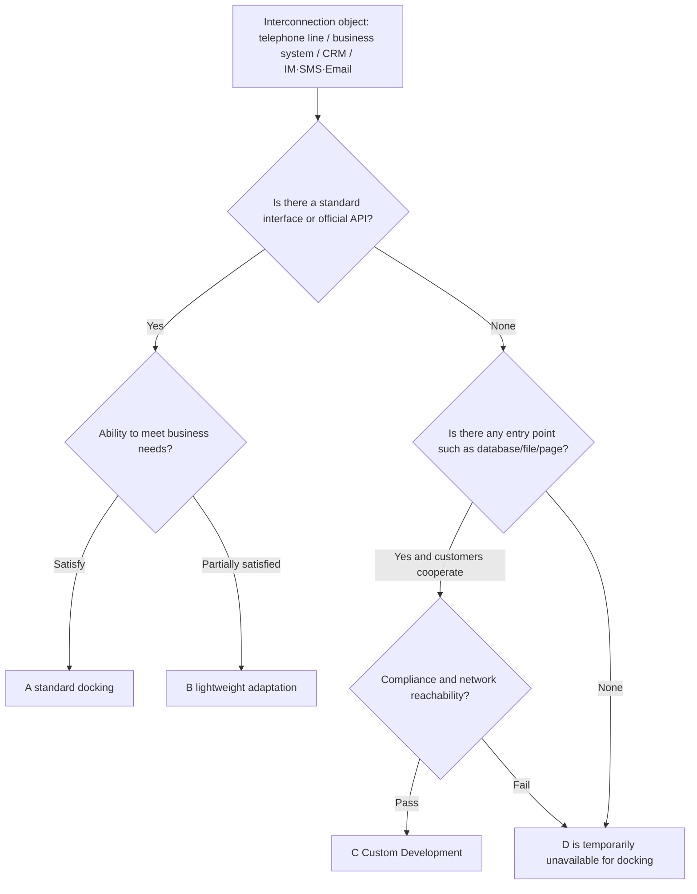

## Overview and scope of application

This document is used in the pre-sales and solution evaluation stages to unify the judgment of "interoperability": when facing new customers or new projects, quickly determine whether the customer's phone lines, business systems, customer relationship management systems (CRM), instant messaging (IM), SMS, email and other channels can be connected with our voice AI system; which path can be taken, what the cost level is, whether customized development is needed, and standardized judgment conclusions are given.

Our system carries voice media through self-deployed LiveKit (WebRTC media forwarding) and livekit-sip (SIP/RTP gateway). After leaving the system, it lands on the telephone network via SIP Trunk. The calculation of media delay for each telephone link will not be repeated in this article, see<cite doc-id="YM1WdkwAOoOGD9xVfjFjDltvpBc" file-type="docx" title="端到端延迟计算" type="doc"></cite>; See the cooperation model with customers who already have call centers.<cite doc-id="EvRldt9GOoqcFUxAKTujvVvopMh" file-type="docx" title="SI对接方案" type="doc"></cite>; See project grading and delivery boundaries<cite doc-id="Xfa9dAyURoVvLOx2jTkjftDgpvZ" file-type="docx" title="项目分级" type="doc"></cite>;For the manpower and construction period estimate of customized development, please see<cite doc-id="MRbesx2FRhriWGtoYYcjT75UpBb" file-type="sheets" title="人力消耗与开发工期估算" type="doc"></cite>。

## General decision framework and conclusion grading

### Five steps to determine

For any docking object (telephone line, business system, CRM, IM/SMS/email), follow the following five steps to determine in order. If the previous step fails, resolve it first before proceeding to the next step:

1. **Find the entry point**: Whether there are standard interfaces or protocols on the client side (SIP, REST API, Webhook, SMTP, official open platform, etc.).
2. **experience ability**: Whether the interface capabilities meet business needs - authentication method, queryable/writable field range, real-time performance, concurrency and current limit, message and template restrictions.
3. **Internet access**: Whether the network is reachable (public network API, enterprise dedicated line, VPN, or adaptation services need to be deployed on the customer's intranet).
4. **Over compliance**: Whether data and security are met - personal information protection (Japan's Personal Information Protection Act, APPI, etc.), whether the data can be released from the customer environment within the agreed scope, log desensitization, and customer security assessment.
5. **Calculate cost and construction period**: Check whether the cost level and development workload are within the project budget.

### Conclusion grading

| grade | meaning | Typical characteristics | reference period |
|-|-|-|-|
| A | Standard docking | Standard protocol or official API, pure configuration or ready-made connector can be used | 1–2 weeks |
| B | Lightweight adaptation | The interface is standard, but requires a small amount of development or application (field mapping, callback transformation, account and template review, etc.) | 2–4 weeks |
| C | Custom development | There is no standard interface, but there are available entry points such as databases, files, pages, etc., and development needs to be scheduled according to needs. | Estimate based on manpower and construction period |
| D | Not currently available for docking | There is no technical entry point, or customer cooperation, compliance, and security assessments fail. | Change path or postpone |

The judgment conclusion for each docking object must include five items: judgment level, docking path/method, preconditions (resource list to be provided by the customer), workload estimate, and cost magnitude.

## Common routes and costs for telephone line connection

### Common docking paths

Telephone line connection refers to the connection between our system and the telephone network (PSTN) and the customer's telephone system. The path number is consistent with the link number in "End-to-End Delay Calculation". The media delay interval of each path can be found in that document and will not be repeated here:

| path | media trends | Applicable scenarios | Preconditions | conventional conclusion |
|-|-|-|-|-|
| Link 1 · Public network outbound call (PSTN direct connection) | Our system → SIP Trunk → PSTN → Customer mobile/landline | Not connected to the customer's phone system, dial the customer's public network number directly | No special conditions, just our line and number resources | A |
| Link 2 · Direct connection to customer telephone exchange (PBX) | Our system → SIP Trunk (Enterprise Private Line/VPN) → Customer PBX → Internal phone, or outbound call via PBX | Completed SIP Trunk connection with customer PBX | Customer PBX supports standard SIP; dedicated line or VPN available; network reachable | A/B |
| Link three · PBX public network number transfer | Our system → SIP Trunk → PSTN → Customer PBX public network number (DID) → Outbound PSTN → Customer phone number | The customer's PBX cannot be directly connected to us and is relayed through its public network number (traversing the PSTN twice) | The customer provides a public network number and extension route that can be transferred; it is recommended to use DID directly to avoid secondary dialing through voice navigation at the switchboard | B |
| Transfer manual · Bridge mode | Keep the call with the customer unchanged, initiate a new call to the customer service and bridge it on our side; the customer service side is divided into three lines: direct connection to the PBX internal agent/PSTN customer service number/PBX public network number to extension | AI call transfer to human agent | Clarify the seat location (PBX extension/public network number/customer call center) | With main link |

- The manual transfer adopts the bridge mode: the audio in the manual stage is bridged by us throughout the entire process, which can be recorded, transcribed and quality checked.
- If the customer already has a call center platform and is unwilling to change it, there are three other cooperation models (the call center leads the phone management / the open interface is led by us / we directly connect to the PSTN for data synchronization only), see "SI Docking Plan".

### Determination conditions for dockability (information collection list)

Before making a decision, collect the following information from the customer:

- Customer phone system: whether there is a PBX or call center platform; make and model; whether it supports standard SIP (trunk access and SIP extensions).
- Number resources: Explicit number ownership (applied by us or provided by the customer); the Japanese side needs to distinguish between 0AB-J fixed numbers and 050 IP phone numbers, which are different in apparent credibility and callable range.
- Network conditions: Can enterprise dedicated lines/VPN/public network whitelists be provided; firewall and address translation (NAT) policies.
- Media parameters: codec (G.711, etc.), whether transcoding is required, whether the PBX supports media bypass (the media does not pass through the PBX during the call).
- Traffic model: number of concurrent channels, ratio of outbound calls and incoming calls, ratio of transfer labor, and daily traffic volume (number of minutes).
- Agent side information: The location of the manual agent (customer PBX extension, public network number, or customer call center agent) determines the transfer path.

| Customer condition combination | Recommended path | conventional conclusion |
|-|-|-|
| There is no PBX, or it is not connected to the customer phone system. | link one | A |
| There is a PBX, supports SIP, and can open a dedicated line/VPN/public network direct connection | Link 2 (delay and cost are usually optimal) | A/B |
| There is a PBX, but it cannot be directly connected to us | Link three; you can also return to link one when the internal line is not required to land. | B |
| Requires manual transfer | Overlay bridge transfer on any primary link | With main link |
| The customer already has a call center platform and is unwilling to change it | Separate evaluation based on the three modes of "SI Docking Plan" | Another comment |

### Cost composition and magnitude

| Cost item | illustrate | Magnitude reference |
|-|-|-|
| Line landing fee | PSTN call charges or SIP Trunk minute charges are based on the operator/line service provider's price; each path only occurs once | The difference mainly comes from the implementation target (fixed phone/mobile phone, domestic/international). It is necessary to inquire and calculate the price from the line service provider according to the traffic model. |
| Number monthly rental | Monthly rent for external number and DID number | The price depends on the number type (fixed / 050 / mobile phone number) and quantity. |
| SIP Trunk line fee | Link 2 only: Monthly rental and one-time activation fee for enterprise dedicated line or VPN | Quotation based on customer network conditions |
| Platform usage fee | Occurs only when connected via a third-party cloud platform (such as Genesys Cloud) | Genesys reference price: Audio Connector is priced at \$0.10/minute (approximately 12 yen/minute, effective from January 2026, no free quota, only IVR channel, cannot bridge manual agents); BYOC cloud relay (customers bring their own lines to connect to the Genesys cloud) includes 5,000 minutes per seat per month, and the excess is approximately \$0.0012/minute |
| Custom development fee | Happens only for C-level paths | Calculated according to "Manpower Consumption and Development Period Estimation" |

<callout emoji="💡">
Calculation caliber: Externally presented as two unit prices - "AI reception minute unit price + transfer labor minute unit price". LiveKit is self-deployed and does not incur platform fees; line landing fees only occur once for each path; one-time or periodic fees such as monthly number rental, dedicated line activation fees, and seat licenses are not included in the unit price and are listed separately by item.
</callout>

## Judgment conditions for customizable development

When the docking object does not meet A/B (no standard interface, or standard interface capability is insufficient), first determine whether customized development can be carried out according to this section (C). If neither is satisfied, then D is determined.

### Necessary conditions for judging C (customizable development)

The following five conditions must be met:

1. There is at least one technical entry point: the customer system database (read-only view or dedicated account); the interface behind the customer system page (packet capture analysis is possible and has written approval from the customer); file or message middleware exchange (CSV scheduled export, SFTP, message queue); the customer is willing to develop cooperation modules within its system (customer R&D participation).
2. Customer cooperation meets the standard: there is a clear technical docking person; the test environment and desensitization test data can be provided; there are interface documents, or packet capture analysis is allowed during joint debugging.
3. The workload is controllable: the estimated manpower and construction period are within the project budget (see "Manpower Consumption and Development Period Estimation").
4. The boundaries of maintenance responsibilities are clear: When a customer system upgrade results in an interface or page change, who is responsible for the adaptation and how long the response will take have been agreed in the contract or plan (see "Project Classification").
5. Compliance allowed: the personal information involved can be used and transferred within the agreed scope; passes the customer security assessment; meets the requirements of the Personal Information Protection Act (APPI) and other requirements.

### Trigger conditions for judgment D (temporarily unavailable for docking)

- There is no technical entry point, and the customer has no willingness to cooperate in R&D.
- Data is not allowed to leave the customer environment, and the customer does not accept the deployment of adaptation services on the customer's intranet.
- Data can only be obtained through reverse engineering of the page without written approval from the customer.
- The investment in custom development is close to or exceeds the expected income of the project, and the input-output is not established.

### Output requirements

When the judgment is C, the "customized development evaluation form" is output: entry point type, involved interfaces and data list, estimated man-days, risks and dependencies, and acceptance criteria, as the basis for quotation and scheduling.

## Determining conditions for the dockability of business systems

The business system refers to the system on the client side that carries business data and needs to be queried or written back during the AI ​​dialogue process: orders, work orders, appointments, members, ERP, inventory, etc. When judging, match according to the following "entry point ladder" from top to bottom, and take the first hit ladder:

| ladder | entry point | conventional conclusion | illustrate |
|-|-|-|-|
| 1 | Official API (REST / SOAP / GraphQL), with documentation and testing environment | A | Pure configuration or lightweight packaging is enough |
| 2 | Official SDK / Webhook / Message push | A/B | Can be connected with a small amount of development |
| 3 | File exchange (CSV/SFTP scheduled export and import) | B/C | Non-real-time, only suitable for customer list synchronization, batch write-back and other scenarios |
| 4 | Direct reading of database (read-only view/dedicated account) | C | Requires cooperation from customer database administrator, paying attention to field semantics and data quality |
| 5 | Page interface reverse engineering/RPA | C/D | Fragile, the customer system will become invalid upon upgrade; the customer must agree in writing and agree on maintenance responsibilities |

### Ability matching judgment point

After hitting the ladder, check the following judgment points. Failure to meet any of them will affect the level or feasibility:

- Authentication method: OAuth 2.0 / API Key / Basic / IP whitelist; who applies for credentials and how to rotate them.
- Data scope: Whether the fields required for AI dialogue (order status, reservation records, membership levels, blacklists, etc.) can be found; personal information fields are applied based on the principle of minimization.
- Real-time: It is recommended that P95 be within 1 second for a single query response, otherwise the rhythm of the conversation will be affected.
- Concurrency and current limiting: Whether the interface quota (call limit per second/daily) can cover the traffic peak.
- Writing ability: whether you can write back call notes, create work orders or make appointments; repeated submissions require idempotent processing.
- Network reachability: public network API/dedicated line/VPN; if none of them are reachable, can the adaptation service be deployed on the customer's intranet?

Conclusion output: Judgment level + The customer needs to provide a list (interface document, test environment and account, current limit quota, field dictionary).

## CRM system dockability judgment conditions

CRM is first judged by applying the "entry point ladder" in the previous section: mainstream SaaS CRM (Salesforce, Microsoft Dynamics 365, HubSpot, Zoho, kintone, etc.) open platforms are mature, usually A/B; self-developed CRM is judged according to the ladder. On this basis, supplement the unique judgment points of CRM:

| decision point | content | Handling when dissatisfied |
|-|-|-|
| Call record write back | Can you create call records/activity records and associate contacts, support custom fields | Downgrade to file or email writeback; or judge C to develop intermediate table |
| Contact reverse check | Is it possible to query contacts by incoming/outgoing call number; number field format (country code, separator) and uniqueness | Inconsistent formats require development of number normalization (B) |
| Agent pop-up screen | Whether artificial agents need pop-up screens for incoming calls; whether the CRM supports phone integration frameworks such as Open CTI | It can be ignored when there are no artificial agents in pure AI scenarios. |
| Custom objects and fields | Whether custom objects/fields have documents; whether new objects are allowed to store AI dialogue results | Requires cooperation from customer CRM administrator (B) |
| API quota | Can the API call volume limit and billing method cover the call volume? | The customer needs to expand the capacity, or we can do caching and request merging (B) |
| Data residency and compliance | Whether the CRM data can be transferred to us within the agreed scope; whether the customer compliance approval has been passed | When not allowed, the adaptation service can only be deployed on the client side, or it is judged as D |

## Determining conditions for interoperability of IM, SMS, email and other channels

### Instant Messaging (IM)

| channel | Judgment points | conventional conclusion |
|-|-|-|
| LINE official account (mainstream in Japan) | The Messaging API standard is open; it needs to be accessed with an official account authenticated by the customer; messages are billed by type, and some message templates need to be reviewed. | A |
| WhatsApp Business | Accessed through the official cloud API or service provider; enterprise verification is required; only template messages that have passed the review can be sent outside the 24-hour customer service window | A/B |
| Website online chat | We provide the chat component to be embedded into the customer's website; the script can be online on the customer's website | A |
| Feishu / Business WeChat / DingTalk | The open platform API is mature; customer administrators are required to create applications and authorize them | A |
| Customer-built IM | Whether there is an API or message push mechanism is determined according to the "entry point ladder" of the business system | B–D |

Common judgment points: Account owner ownership (determines the party responsible for billing and compliance); message templates and review cycles; sending frequency limits; user unsubscription (opt-out) mechanism.

### Short message

- Sending channel: The customer's own SMS gateway (A/B), or our docking operator/aggregation channel (A, the unit price is based on the channel price).
- Judgment points: countries and number types that can be sent (most landlines in Japan cannot receive text messages, and mobile phone numbers are the main ones); sender name (Sender ID) display rules; variable templates; arrival rate and unit price; handling of bounced letters and user replies.

### mail

- Sending method: SMTP relay (customer provides account or relay service) or email service provider API, both are A.
- Judgment points: domain name ownership and DNS configuration permissions for sending emails (SPF / DKIM / DMARC, incorrect configuration will significantly affect the arrival rate); templates and variables; bounce and complaint handling; sending frequency limits.
- Compliance: Japan's "Specified Email Law" requires commercial emails to indicate the sender's information and unsubscribe method. Before sending, you need to confirm that the template is met; at the same time, you must comply with the customer's internal email specifications.

## Judgment conclusion summary template

For each customer/project, output a summary table as input for plans and quotations:

| docking object | Judgment level | Docking path/method | Preconditions (customers need to provide) | Effort Estimation | cost level | Remark |
|-|-|-|-|-|-|-|
| telephone line |  |  |  |  |  |  |
| business system |  |  |  |  |  |  |
| CRM |  |  |  |  |  |  |
| IM |  |  |  |  |  |  |
| Short message |  |  |  |  |  |  |
| mail |  |  |  |  |  |  |
