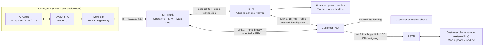
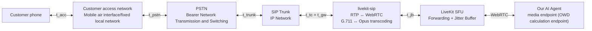
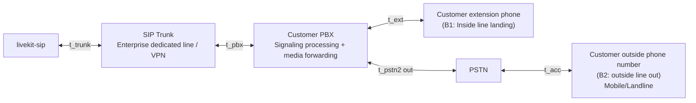
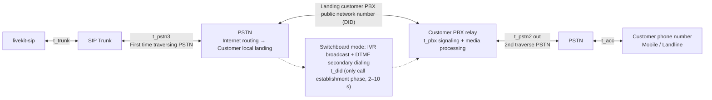

## Overview

This document defines our voice AI system to the customer's phone side**Media one-way delay (OWD) of each link**, giving a unified index caliber, segmented calculation method and schematic diagram. Our system is deployed through an independent sub-system**LiveKit**(WebRTC SFU) with**livekit-sip**(SIP/RTP gateway) carries voice media and passes through**SIP Trunk**Implemented into the telephone network, covering a total of 6 paths (3 main links + 3 transfer paths):

- **Link one (PSTN direct connection)**:livekit-sip → SIP Trunk → PSTN → Customer Mobile/Landline.
- **Link two (via customer PBX)**: livekit-sip → SIP Trunk → customer PBX → customer internal phone; or the customer PBX calls the customer external phone via PSTN.
- **Link three (PBX via PSTN)**: livekit-sip → SIP Trunk → PSTN → Customer PBX → Outgoing PSTN → Customer mobile phone/landline (when the customer PBX cannot be directly connected to us, it will be forwarded through its public network number, crossing the PSTN twice; for the scenario of transferring to an internal extension, see transfer ③).
- **Transfer manual**: During the AI ​​call, initiate a second call to customer service and bridge it. The customer service side path is divided into three paths - SIP Trunk → customer PBX internal agent (direct connection); SIP Trunk → PSTN → customer service phone number; SIP Trunk → PSTN → customer PBX public network number → internal extension (PBX non-direct connection).

<callout emoji="💡">
The segmentation delays in this article are all**Typical reference interval**, used for magnitude cognition and budget modeling; before committing to external SLA, it must be replaced after actual measurement and calibration according to the management method in Section 9.
</callout>

## Link overview

The three main AI dialogue links share the network segment within our system (LiveKit SFU, livekit-sip), and the difference lies in the landing method after the SIP Trunk; the transfer manually reuses the same SIP Trunk outlet, with only the call destination being different (directly connected PBX extension number, PSTN customer service number, or customer PBX public network number landing via PSTN). The media delay after transfer is calculated separately for the client side and customer service side links (see Chapter 7 section).

| serial number | media path | Applicable scenarios |
|-|-|-|
| link one | Our system → SIP Trunk → PSTN → Customer mobile/landline | Not connected to the customer's PBX, dial the public network number directly |
| Link two | Our system → SIP Trunk → Customer PBX → Internal phone; or PBX outgoing → PSTN → Customer external phone | PBX connection has been completed with the customer (enterprise dedicated line/VPN SIP Trunk) |
| Link three | Our system → SIP Trunk → PSTN → Customer PBX transit → PSTN → Customer mobile phone/landline (twice traversing PSTN) | The customer's PBX cannot be directly connected to ours, and outbound calls are forwarded through its public network number (DID); for the scenario of transferring to an internal extension, see transfer ③ |
| Transfer ① | Our system → SIP Trunk → Customer PBX → Internal agent extension | The customer service agent is registered on the customer's PBX extension, and the PBX is directly connected to us |
| Transfer② | Our system → SIP Trunk → PSTN → Customer service phone number | Customer service is a public network mobile phone/landline, or is not within the customer's PBX extension |
| Transfer ③ | Our system → SIP Trunk → PSTN → Customer PBX public network number → Internal agent extension | The customer service agent is on the customer's PBX extension, but the PBX is not directly connected to us (including secondary dialing via IVR) |

## Definition and general calculation method of delay index

### Indicator definition

This document adopts uniform**Media one-way delay (One-Way Delay, OWD)**: During a call, one end sends a voice frame → the one-way propagation time that the other end can play, that is, the one-way delay for voice to pass through the entire link of "customer phone ↔ our system" or "our system ↔ customer service". Quality target benchmark ITU-T G.114: One-way ≤ 150 ms is high-quality voice.

### General calculation method: segmented accumulation

Divide the entire link into standard network segments, measure or estimate the delay of each segment separately and then accumulate them. The upstream and downstream media paths are symmetrical (reverse transmission on the same network segment). When the actual measurement is asymmetric, the values ​​are respectively:

$$T_{owd} = \sum_{i} t_{i}$$

That is, the sum of the delays of each network segment. For network segment symbols, see the segment table in Section 4-6. Statistical caliber: P50 is used as the budget and P95 is used as the upper limit for each segment; the jitter buffer uses a steady-state value based on the target network conditions.

## Link 1: SIP Trunk → PSTN → Customer Phone

### Segmented delay composition

| symbol | Network segment/link | Composition description | Typical reference values ​​(unidirectional) |
|-|-|-|-|
| t_acc | customer access network | Fixed local network/mobile air interface (4G, 5G RAN) | Landline 5–30 ms; mobile 50–150 ms |
| t_pstn | PSTN | Carrier network transmission, switching, and packetization (local/long-distance/international differences are large) | 20–80 ms |
| t_trunk | SIP Trunk | Our IP network to the operator/ITSP (RTT half + packet) | Dedicated line 10–30 ms; public network 20–80 ms |
| t_tc | Codec/Transcoding | G.711 ↔ Opus transcoding in livekit-sip (frame length + algorithm delay); only packets are packetized when the codec is consistent | 20–40 ms with transcoding; 5–10 ms without transcoding |
| t_gw | livekit-sip gateway | RTP ↔ WebRTC adaptation and forwarding processing | 5–20 ms |
| t_jb | LiveKit / WebRTC | SFU forwarding + receiver adaptive jitter buffer (NetEQ) | 30–100 ms |

### Calculation formula

The one-way media delay of link one is the sum of all network segments (symmetrical uplink and downlink):

$$T_{owd}^{A} = t_{acc} + t_{pstn} + t_{trunk} + t_{tc} + t_{gw} + t_{jb}$$

### OWD reference interval

| scene | One-way media delay OWD (reference) |
|-|-|
| Mobile customers (public network SIP Trunk) | 0.14–0.47 s |
| Landline customers (public network SIP Trunk) | 0.08–0.35 s |
| Landline customers + dedicated line Trunk (optimal combination) | About 0.09 s |

Conclusion: Link 1 OWD reference interval is approximately**0.08–0.47 s**, mainly contributed by the access network (mobile air interface), PSTN bearer and transcoding/jitter buffer; the mobile customer scenario has significantly exceeded the 150 ms target of ITU-T G.114, and the optimization direction is dedicated line trunk, reducing transcoding and tightening the jitter buffer.

## Link 2: SIP Trunk → Customer PBX → Customer phone

### Increment relative to link one

Link 2 and Link 1 share the internal segment of our system and the SIP Trunk segment. The difference is after the Trunk: the media first enters the customer PBX and then decides on the landing method. The new/replaced sections are as follows:

| symbol | Network segment/link | Composition description | Typical reference values ​​(unidirectional) |
|-|-|-|-|
| t_pbx | Customer PBX | Signaling processing + media forwarding; significantly increased if PBX transcoding or media not bypassed (media passes through PBX media board) | Media forwarding 2–10 ms; transcoding 20–60 ms |
| t_ext | internal line | Enterprise intranet link from PBX to internal phone | 1–5 ms |
| t_pstn2 | PBX outgoing → PSTN | Only the "PBX outbound call outside line" scenario exists, which is equivalent to the PSTN segment of link one. | 20–80 ms |

### Calculation formula

Assume B1 = PBX internal line landing, B2 = PBX outgoing call to outside line, replace the tail segment based on the link one formula:

$$T_{owd}^{B1} = t_{trunk} + t_{pbx} + t_{ext} + t_{tc} + t_{gw} + t_{jb}$$

$$T_{owd}^{B2} = T_{owd}^{B1} + t_{pstn2} + t_{acc}$$

- **B1 (inside line landing)**: Remove the PSTN and access network segments and replace them with PBX and internal lines. The network segment is significantly smaller than link one;
- **B2 (outside line)**: The PSTN and access network segments remain the same, with only one additional PBX hop added;
- If the customer PBX supports**media bypass**(The media does not go through the PBX after re-INVITE), t_pbx only exists in the signaling phase, and is counted as 0 during the call.

## Link three: SIP Trunk → PSTN → Customer PBX → PSTN → Customer phone (traversing PSTN twice)

When the customer's PBX cannot be directly connected to our system (dedicated line/VPN SIP Trunk conditions are not met), outbound calls are forwarded through the customer's PBX's public network number (DID), and then the outbound call is made by the PBX to the customer's phone number: Media**Crossing the PSTN twice**, the customer PBX only performs transfer, and the client-side terminal is still an ordinary mobile phone/landline, not inside the PBX (the internal extension scenario only appears on the customer service side of manual transfer, see transfer ③). This link has the longest media delay among the three main links.

### Segmented delay composition

Share the internal segments (t_tc, t_gw, t_jb) and SIP Trunk segments of our system; the sequence is then the 1st PSTN traversal → customer PBX transit → 2nd PSTN traversal → customer access network. New/reused segments are as follows:

| symbol | Network segment/link | Composition description | Typical reference values ​​(unidirectional) |
|-|-|-|-|
| t_pstn3 | 1st PSTN traverse | Our Trunk outbound → operator's inter-network routing → customer PBX local landing (public network number / DID line) | 20–90 ms (upper limit for long distance/international) |
| t_pbx | Customer PBX relay | Signaling processing + media forwarding (multiplexing defined in 5.1) | Media forwarding 2–10 ms; transcoding 20–60 ms |
| t_pstn2 + t_acc | The 2nd PSTN traversal and customer access network | PBX outgoing → PSTN → customer access network → customer phone (reuse 4.1 / 5.1 definition) | Landline 25–110 ms; mobile 70–230 ms |
| t_did | PBX call routing | DID direct: outgoing via routing upon landing; switchboard mode: automatic attendant IVR broadcast + DTMF second dialing before outgoing, only exists in the call establishment phase | DID ≈ 0; switchboard + IVR 2–10 s |

### Calculation formula

$$T_{owd}^{C} = t_{trunk} + t_{pstn3} + t_{pbx} + t_{pstn2} + t_{acc} + t_{tc} + t_{gw} + t_{jb}$$

When the two PSTN traversal delays are similar (t_pstn3 ≈ t_pstn2 ≈ t_pstn), it can be directly derived from link one - link three is "link one + customer PBX transfer + one additional PSTN traversal":

$$T_{owd}^{C} \approx T_{owd}^{A} + t_{pbx} + t_{pstn}$$

- Compared with link one: there are two more sections: "customer PBX transfer + one additional PSTN traversal", which is the longest media delay among the three main links;
- The client-side terminal is still an ordinary mobile phone/landline; the one-time traversal scenario of "SIP Trunk → PSTN → Customer PBX → Internal Extension" is only used to transfer to the manual customer service side (transfer ③, see Section 7);
- Media one-way delay reference: fixed-line customer appointment**0.11–0.5 s**, mobile customers about**0.16–0.62 s**; t_did in switchboard mode only affects call establishment before connection, but does not affect the media delay after connection. It is recommended to use DID direct routing.

## Transfer manual (bridge mode)

### Bridge transfer (the only method in this plan)

- **bridge transfer**: livekit-sip keeps the existing call with the customer unchanged, and initiates a new call to customer service. The two calls are bridged in our LiveKit room; during this period, the customer can listen to the waiting tone or continue the announcement by AI. After the transfer, the media is fixed to our bridge. The media delays of the links on both sides are calculated separately and then added together. The scenarios are given in the following sections.
- **Transfer ③ (PBX not directly connected)**: Customer service side calls are dialed to the public network number of the customer PBX via PSTN and then transferred to the internal extension; DID direct and switchboard IVR secondary dialing only affect the waiting before connection, and the media delay after connection is the same (see the next section).

### Media delay after transfer

Under bridge transfer, the one-way media delay of the call after transfer is the sum of the client-side link and the customer-side link - the client-side link refers to the section from the customer to our system, and the customer-side link refers to the section from our system to the customer service; both links already contain the forwarding section in our system, which is consistent with the OWD caliber of each link in Sections 4-6, and the dialogue loop (bidirectional) is twice that (cust, agent in the formula) Representing the customer side and customer service side links respectively):

$$T_{owd}^{after} = T_{owd}^{cust} + T_{owd}^{agent}$$

**client side link**(Customer ↔ Our system, according to the main link scenario in Section 4–6):

| Client side link scenario | via | One-way media OWD theoretical scope |
|-|-|-|
| Link 1 · Mobile customers | SIP Trunk → PSTN → Mobile air interface | 0.14–0.47 s |
| Link 1·Landline customers | SIP Trunk → PSTN → Fixed local network | 0.08–0.35 s |
| Link 2·PBX internal line (direct connection) | SIP Trunk → Customer PBX → Intercom Phone | 0.05–0.31 s |
| Link 2·PBX outgoing line | SIP Trunk → Customer PBX → PSTN → Customer Phone | 0.08–0.54 s |
| Link 3·Transferred via PBX (Landline customers) | SIP Trunk → PSTN → Customer PBX Transit → PSTN → Fixed Local Network | 0.11–0.5 s |
| Link 3·Transit via PBX (mobile customers) | SIP Trunk → PSTN → Customer PBX transit → PSTN → Mobile air interface | 0.16–0.62 s |

**Customer service side link**(Our system ↔ Customer Service, according to the transfer path):

| Customer service side link scenario | via | One-way media OWD theoretical scope |
|-|-|-|
| Transfer ① · Trunk directly connected to PBX internal agent | SIP Trunk → Customer PBX → Internal agent extension | 0.05–0.31 s |
| Transfer ② · PSTN customer service hotline (mobile) | SIP Trunk → PSTN → Mobile air interface | 0.14–0.47 s |
| Transfer ② · PSTN customer service hotline (landline) | SIP Trunk → PSTN → Fixed local network | 0.08–0.35 s |
| Transfer ③ · PSTN → PBX public network number → extension | SIP Trunk → PSTN → Customer PBX → Internal Agent Extension | 0.09–0.4 s (t_did only affects call establishment, not the media during the call) |

Combination upper and lower bounds: Optimal combination (link 2 PBX directly connected to internal customers + transfer ①) one-way appointment**0.10–0.62 s**; Worst combination (link three mobile customer + transfer ② mobile customer service) one-way appointment**0.30–1.09 s**;The one-way theoretical interval of all combinations is**0.10–1.09 s**, dialogue loop (two-way)**0.2–2.2 s**. After the transfer, it is a pure media link with no AI processing section. However, after the links on both sides are superimposed, the OWD has clearly exceeded the 150 ms target of ITU-T G.114. The long link combination (link three/mobile customer + via PSTN customer service) needs to be focused on in capacity planning and experience evaluation.

## Media one-way delay summary

| path/scene | One-way media delay OWD (reference) |
|-|-|
| Link 1 · Mobile customers | 0.14–0.47 s |
| Link 1·Landline customers | 0.08–0.35 s |
| Link 2·PBX internal line landing (direct connection) | 0.05–0.31 s |
| Link 2·PBX outgoing line | 0.08–0.54 s |
| Link 3: Relayed via PBX, traversing PSTN twice (landline customers) | 0.11–0.5 s |
| Link Three · Relayed via PBX, traversing PSTN twice (mobile customers) | 0.16–0.62 s |
| Calls after transfer · Total links on both sides of the bridge | 0.10–1.09 s (conversation loop approximately 0.2–2.2 s) |

Interpretation: The OWD difference in each scenario is mainly determined by the landing path (0.05–0.62 s). Link three (two passes through PSTN + PBX transfer) is the longest; the transfer adopts the bridge mode. After transfer, the OWD is the sum of the customer side and customer service side links (0.10–1.09 s). The long link combination (link three / mobile customer + via PSTN Customer service) needs to focus on; transfer ③ is recommended to use DID to reach the extension directly.

## Actual measurement and calibration

### RBI position

| Location | Organize content | tool |
|-|-|-|
| livekit-sip | RTP first packet sending and receiving timestamp, RTCP delay report (direct source of OWD), packet loss and jitter | Component logs, tcpdump / Wireshark |
| LiveKit SFU | Room join, track subscription and first frame arrival, forwarding and buffering time | LiveKit telemetry / Prometheus |
| Whole link dial test | The test call injects reference audio and collects it from the opposite end to measure the real loop delay (÷2 to get OWD) | Dial test script + dot alignment |

### Calibration process

1. Initiate dial tests for 3 main links (5 landing scenarios) and link combinations on both sides of the transfer (recommended not less than 100 times per scenario, covering busy/idle times);
2. Collect delay samples from each segment and output P50/P95/P99 distribution;
3. Use the measured distribution to replace the "typical reference values" in each table of this article and recalculate the summary table;
4. Single-column scenario caliber for segments with large differences (such as international PSTN, weak network mobile);
5. Based on this, determine the external SLA caliber and alarm threshold (for example, OWD P95 > 0.5 s triggers an alarm).
