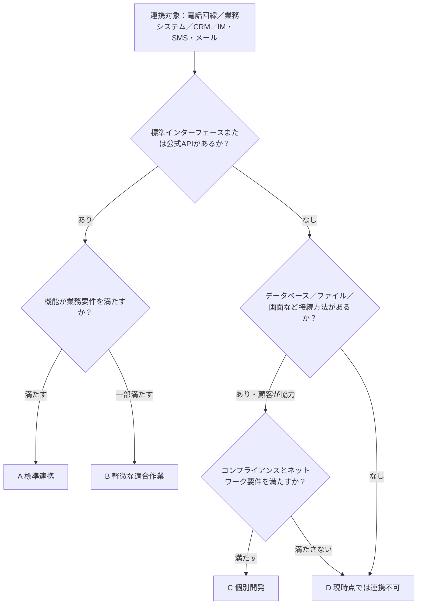

## 概要と適用範囲

本書は、プリセールスおよび提案評価の段階で「連携可否」の判定基準を統一するためのものです。新規顧客や新規プロジェクトについて、顧客側の電話回線、業務システム、顧客管理システム（CRM）、インスタントメッセージ（IM）、SMS、メールなどを当社の音声AIシステムと連携できるか、どの経路を採用できるか、コストの目安はいくらか、個別開発が必要かを迅速に判断し、標準化した結論を提示します。

当社システムでは、自社運用のLiveKit（WebRTCメディア転送）とlivekit-sip（SIP/RTPゲートウェイ）で音声メディアを処理し、システム外ではSIP Trunk経由で電話網に接続します。電話経路ごとのメディア遅延の計算は本書では扱わず、 <cite doc-id="JwXBdIB3doeJCBxM65xjkCCLp4Z" file-type="docx" title="[社内文書] エンドツーエンド遅延の計算" type="doc"></cite>を参照してください。顧客が既存のコールセンターを利用している場合の連携方式は <cite doc-id="ObKsdeTwAoWyIExPeo0jXXbHpHh" file-type="docx" title="[社内文書] SI連携方式" type="doc"></cite>を、プロジェクトの分類と納品範囲は <cite doc-id="Xfa9dAyURoVvLOx2jTkjftDgpvZ" file-type="docx" title="项目分级" type="doc"></cite>を、個別開発の工数・期間の見積もりは <cite doc-id="MRbesx2FRhriWGtoYYcjT75UpBb" file-type="sheets" title="人力消耗与开发工期估算" type="doc"></cite>。

## 共通の判定フレームワークと評価区分

### 5段階の判定手順

連携対象（電話回線、業務システム、CRM、IM／SMS／メール）ごとに、次の5段階で順に判定します。前段階を満たさない場合は、解決してから次に進みます。

1. **接続方法を確認**：顧客側に標準インターフェースやプロトコル（SIP、REST API、Webhook、SMTP、公式開発者プラットフォームなど）があるかを確認します。
2. **機能要件を確認**：インターフェースの機能が業務要件を満たすかを確認します。認証方式、読み取り／書き込み可能なフィールド、リアルタイム性、同時実行数とレート制限、メッセージやテンプレートの制約を確認します。
3. **ネットワーク接続を確認**：ネットワークに到達できるかを確認します（パブリックAPI、専用線、VPN、または顧客の社内ネットワークへのアダプター配置）。
4. **コンプライアンスを確認**：データ保護とセキュリティの要件を満たすかを確認します。個人情報の保護（日本の個人情報保護法、APPIなど）、合意した範囲での顧客環境外へのデータ送信、ログのマスキング、顧客側のセキュリティ審査を確認します。
5. **コストと期間を見積もり**：連携コストの規模と開発工数がプロジェクトの予算内に収まるかを確認します。

### 評価区分

| 区分 | 説明 | 主な特徴 | 期間の目安 |
|-|-|-|-|
| A | 標準連携 | 標準プロトコルまたは公式APIを利用し、設定のみ、または既存コネクターで連携可能 | 1～2週間 |
| B | 軽微な適合作業 | 標準インターフェースを利用できるが、少量の開発や申請が必要（フィールドマッピング、コールバックの調整、アカウント・テンプレートの審査など） | 2～4週間 |
| C | 個別開発 | 標準インターフェースはないが、データベース、ファイル、画面などを接続方法として利用でき、要件に応じた開発が必要 | 工数・期間に基づき見積もり |
| D | 現時点では連携不可 | 技術的な接続方法がない、または顧客の協力度、コンプライアンス、セキュリティ審査の要件を満たさない | 別の経路を検討、または保留 |

連携対象ごとの判定結果には、次の5項目を含めます。評価区分、連携経路／方式、前提条件（顧客に用意いただくリソース）、工数の見積もり、コストの目安。

## 電話回線の主な連携経路とコスト

### 主な連携経路

電話回線連携とは、当社システムと電話網（PSTN）および顧客の電話システムを接続する方式を指します。経路番号は『エンドツーエンド遅延の計算』の経路番号と統一しています。各経路のメディア遅延範囲は同文書を参照してください。ここでは重複して記載しません。

| 経路 | メディア経路 | 適用シナリオ | 前提条件 | 標準的な評価 |
|-|-|-|-|-|
| 経路1・公衆網への発信（PSTN直結） | 当社システム → SIP Trunk → PSTN → 顧客の携帯電話／固定電話 | 顧客の電話システムと連携せず、公衆電話番号へ直接発信 | 特別な条件なし。当社の回線と電話番号のみ必要 | A |
| 経路2・顧客PBXに直接接続 | 当社システム → SIP Trunk（専用線／VPN）→ 顧客PBX → 内線電話機、またはPBXから外線へ発信 | 顧客PBXとのSIP Trunk連携が完了済み | 顧客PBXが標準SIPに対応し、専用線またはVPNを利用可能で、ネットワークに到達できる | A/B |
| 経路3・PBX公衆番号経由の中継 | 当社システム → SIP Trunk → PSTN → 顧客PBXの公衆番号（DID）→ PSTNへ発信 → 顧客電話 | 顧客PBXと当社を直接接続できず、PBXの公衆番号経由で中継（PSTNを2回経由） | 顧客が中継可能な公衆番号と内線ルーティングを用意する。代表番号の音声案内から内線番号を再入力する方式を避け、DIDからの直接ルーティングを推奨 | B |
| 有人対応への転送・ブリッジ方式 | 顧客との通話を維持したまま、オペレーターに別の通話を発信して当社側でブリッジします。オペレーター側には3つの経路があります。PBX内線に直接接続／PSTN経由でオペレーター番号へ接続／PBX公衆番号経由で内線へ転送 | AIとの通話中に有人オペレーターへ転送 | オペレーターの接続先（PBX内線／公衆番号／顧客コールセンター）を明確にする | 主経路に準ずる |

- 有人対応への転送にはブリッジ方式を一律に採用します。有人対応中の音声は常に当社のブリッジを経由するため、録音、文字起こし、品質評価が可能です。
- 顧客が既存のコールセンタープラットフォームを利用しており、変更を希望しない場合は、別途3つの連携方式を検討できます（コールセンターが電話管理を主導／オープンAPI経由で当社が主導／当社がPSTNに直接接続してデータのみ同期）。『SI連携方式』を参照してください。

### 連携可否の判定条件（情報収集リスト）

判定前に、顧客から次の情報を収集してください。

- 顧客の電話システム：PBXまたはコールセンタープラットフォームの有無、メーカーと型番、標準SIP（Trunk接続とSIP内線）への対応状況。
- 電話番号リソース：発信者番号の所有者（当社が申請するか、顧客が用意するか）。日本では0AB-J固定電話番号と050 IP電話番号を区別してください。発信者番号の信頼性と発信可能な範囲が異なります。
- ネットワーク条件：専用線／VPNの提供可否、公衆網のIP許可リスト設定可否、ファイアウォールとNATの設定。
- メディアパラメーター：コーデック（G.711など）、トランスコードの要否、PBXのメディアバイパス対応（通話中にメディアがPBXを経由しない構成）。
- 通話モデル：同時通話数、発信・着信比率、有人対応への転送率、1日の通話量（分）。
- オペレーター側の情報：有人オペレーターの接続先（顧客PBXの内線、公衆番号、顧客コールセンターのいずれか）。転送経路の決定に必要です。

| 顧客の条件 | 推奨経路 | 標準的な評価 |
|-|-|-|
| PBXがない、または顧客電話システムとの連携を当面行わない | 経路1 | A |
| PBXがあり、SIPに対応。専用線／VPN／公衆網経由の直接接続が可能 | 経路2（通常、遅延とコストの面で最適） | A/B |
| PBXがあるが、当社と直接接続できない | 経路3。内線への接続が不要であれば経路1も選択可能 | B |
| 有人対応への転送が必要 | いずれかの主経路にブリッジ転送を追加 | 主経路に準ずる |
| 顧客が既存のコールセンタープラットフォームを利用し、変更を希望しない | 『SI連携方式』の3方式で個別に評価 | 別途評価 |

### コストの内訳と目安

| コスト項目 | 説明 | 目安 |
|-|-|-|
| 回線接続料 | PSTN通話料またはSIP Trunkの分単位料金。通信事業者／回線サービス事業者の料金に基づきます。どの経路でも1回分のみ発生します。 | 主な差は接続先（固定電話／携帯電話、国内／国際）によって生じます。通話モデルに基づき回線サービス事業者へ見積もりを依頼してください。 |
| 電話番号の月額料金 | 発信者番号とDID番号の月額料金 | 番号事業者の料金に基づきます。番号種別（固定／050／携帯）と番号数によって異なります。 |
| SIP Trunk専用線料金 | 経路2のみ：専用線またはVPNの月額料金と初期開通費 | 顧客のネットワーク条件に応じて見積もり |
| プラットフォーム利用料 | Genesys Cloudなど、サードパーティーのクラウドプラットフォーム経由で連携する場合のみ発生 | Genesysの参考価格：Audio Connectorは標準料金で0.10米ドル／分（約12円／分、2026年1月適用開始、無料枠なし。IVR回線専用で、有人オペレーターへのブリッジ不可）。BYOCクラウドトランク（顧客の回線をGenesys Cloudに接続）は、オペレーター1人あたり月5,000分を含み、超過分は約0.0012米ドル／分。 |
| 個別開発費 | C区分の経路でのみ発生 | 『工数・開発期間の見積もり』に基づき算出 |

<callout emoji="💡">
見積もり基準：対外的には「AI応対の分単価＋有人対応への転送の分単価」の2つを提示します。LiveKitは自社運用のため、プラットフォーム利用料は発生しません。回線接続料はどの経路でも1回分のみ発生します。電話番号の月額料金、専用線の開通費、オペレーターライセンスなどの初期費用・定期費用は分単価に含めず、プロジェクトごとに別途記載します。
</callout>

## 個別開発の判定条件

連携対象がA／B（標準インターフェースがない、または機能が不足）を満たさない場合、本節に基づいて個別開発（C）が可能かを判定します。条件を満たさない場合にDと判定します。

### C（個別開発可能）の必須条件

次の5項目すべてを満たす必要があります。

1. 技術的な接続方法が少なくとも1つあること：顧客システムのデータベース（読み取り専用ビューまたは専用アカウント）、顧客システムの画面で使用されるAPI（パケットキャプチャーによる分析が可能で、顧客の書面承認を得ていること）、ファイルまたはメッセージングミドルウェアによる連携（CSVの定期エクスポート、SFTP、メッセージキュー）、または顧客が自社システム内の連携モジュール開発に協力すること（顧客側の開発担当者が参加）。
2. 顧客の協力体制が整っていること：明確な技術担当者がいること、テスト環境とマスキング済みテストデータを提供できること、インターフェース仕様書があるか、接続テスト中のパケットキャプチャー分析が許可されていること。
3. 工数を管理できること：見積もった工数と期間がプロジェクトの予算内であること（『工数・開発期間の見積もり』を参照）。
4. 保守責任の範囲が明確であること：顧客システムのアップグレードによりAPIや画面が変更された場合、誰が対応するか、対応時間をどの程度とするかを契約書または提案書で合意済みであること（『プロジェクト分類』を参照）。
5. コンプライアンス上許可されていること：対象となる個人情報を合意した範囲内で使用・送信できること、顧客のセキュリティ審査に合格していること、個人情報保護法（APPI）などの要件を満たすこと。

### D（現時点では連携不可）と判定する条件

- 技術的な接続方法がなく、顧客に開発協力の意思もない。
- データを顧客環境外に持ち出せず、顧客が社内ネットワークへのアダプター配置も認めない。
- 画面のリバースエンジニアリングでしかデータを取得できず、顧客の書面承認も得られない。
- 個別開発の投資額がプロジェクトの想定収益に近い、または上回り、投資対効果が成立しない。

### 出力要件

Cと判定した場合は「個別開発評価表」を作成します。接続方法の種別、対象となるAPIとデータの一覧、想定人日、リスクと依存関係、受け入れ基準を記載し、見積もりとスケジュールの根拠とします。

## 業務システムの連携可否を判定する条件

業務システムとは、顧客の業務データを保持し、AIとの対話中に参照または書き戻す必要があるシステムを指します。注文、チケット、予約、会員、ERP、在庫などが該当します。判定時は、次の「接続方法の優先順位」を上から確認し、最初に該当するものを採用します。

| 優先順位 | 接続方法 | 標準的な評価 | 説明 |
|-|-|-|-|
| 1 | 公式API（REST／SOAP／GraphQL）。仕様書とテスト環境あり | A | 設定のみ、または軽微なラッパー実装で連携可能 |
| 2 | 公式SDK／Webhook／メッセージプッシュ | A/B | 少量の開発で連携可能 |
| 3 | ファイル連携（CSV／SFTPによる定期エクスポート・インポート） | B/C | リアルタイム性はなく、顧客リストの同期や一括書き戻しなどに適する |
| 4 | データベースの直接読み取り（読み取り専用ビュー／専用アカウント） | C | 顧客側のデータベース管理者の協力が必要。フィールドの意味とデータ品質に注意 |
| 5 | 画面APIの解析／RPA | C/D | 脆弱な方式で、顧客システムのアップグレードで動作しなくなる可能性があります。顧客の書面承認を得て、保守責任を合意する必要があります。 |

### 機能要件の確認項目

該当する優先順位を決めた後、次の項目を確認します。1つでも満たさない場合、評価区分または実現可能性に影響します。

- 認証方式：OAuth 2.0／API Key／Basic／IP許可リスト。認証情報の申請者とローテーション方法。
- データ範囲：AIとの対話に必要なフィールド（注文状況、予約履歴、会員ランク、ブラックリストなど）を参照できるか。個人情報フィールドは最小限の範囲で申請します。
- リアルタイム性：1回の照会応答はP95で1秒以内を推奨します。超過すると対話のテンポに影響します。
- 同時実行数とレート制限：APIの利用枠（1秒／1日あたりの呼び出し上限）が通話のピークをカバーできるか。
- 書き込み機能：通話メモを書き戻す、チケットや予約を作成する機能があるか。重複リクエストに対する冪等性の処理が必要です。
- ネットワーク接続：パブリックAPI／専用線／VPNで接続できるか。いずれも利用できない場合、顧客の社内ネットワークにアダプターを配置できるか。

判定結果：評価区分＋顧客に用意いただくもの（API仕様書、テスト環境とアカウント、レート制限の利用枠、フィールド定義書）。

## CRMの連携可否を判定する条件

まず前節の「接続方法の優先順位」に基づいてCRMを判定します。主要なSaaS CRM（Salesforce、Microsoft Dynamics 365、HubSpot、Zoho、kintoneなど）は開発者プラットフォームが成熟しており、通常はA／Bに該当します。独自開発のCRMは優先順位に基づいて判定します。さらに、CRM固有の確認項目を確認してください。

| 確認項目 | 内容 | 要件を満たさない場合の対応 |
|-|-|-|
| 通話記録の書き戻し | 通話記録／活動記録を作成して連絡先に関連付けられるか。カスタムフィールドに対応しているか。 | ファイルまたはメールでの書き戻しに切り替えるか、Cとして中間テーブルを開発 |
| 連絡先の逆引き | 着信／発信番号で連絡先を検索できるか。電話番号フィールドの形式（国番号、区切り文字）と一意性。 | 形式が一致しない場合は電話番号を正規化する機能を開発（B） |
| オペレーター画面のポップアップ | 有人オペレーターが着信時の画面ポップアップを必要とするか。CRMがOpen CTIなどの電話連携フレームワークに対応しているか。 | AIのみで対応し、有人オペレーターがいない場合は省略可能 |
| カスタムオブジェクトとフィールド | カスタムオブジェクト／フィールドの仕様書があるか。AI対話の結果を保存するオブジェクトを新規作成できるか。 | 顧客側のCRM管理者の協力が必要（B） |
| API利用枠 | API呼び出し数の上限と料金体系が通話量に対応できるか。 | 顧客側で利用枠を拡張するか、当社側でキャッシュとリクエスト集約を実装（B） |
| データの保存場所とコンプライアンス | CRMデータを合意した範囲で当社に送信できるか。顧客のコンプライアンス審査に合格しているか。 | 認められない場合は、顧客側にアダプターを配置するか、Dと判定 |

## IM、SMS、メールなどの連携可否を判定する条件

### インスタントメッセージ（IM）

| チャネル | 確認ポイント | 標準的な評価 |
|-|-|-|
| LINE公式アカウント（日本で主流） | Messaging APIは標準公開されています。顧客名義で認証済みの公式アカウントで接続してください。メッセージは種別ごとに課金され、一部のテンプレートは審査が必要です。 | A |
| WhatsApp Business | 公式Cloud APIまたはサービス事業者経由で接続します。企業認証が必要です。24時間のカスタマーサービス対応時間外は、審査済みのテンプレートメッセージのみ送信できます。 | A/B |
| Webサイトのオンラインチャット | 当社が提供するチャットコンポーネントを顧客のWebサイトに埋め込みます。顧客側でスクリプトを公開できれば利用可能です。 | A |
| Lark／WeCom／DingTalk | 開発者プラットフォームのAPIが整備されています。顧客の管理者がアプリを作成し、権限を付与する必要があります。 | A |
| 顧客独自のIM | APIまたはメッセージプッシュの仕組みがあるかを確認し、業務システムの「接続方法の優先順位」に基づいて判定します。 | B–D |

共通の確認項目：アカウントの名義（課金およびコンプライアンス責任者を決定）、メッセージテンプレートと審査期間、送信頻度制限、ユーザーの配信停止（オプトアウト）手段。

### SMS

- 送信経路：顧客所有のSMSゲートウェイ（A／B）、または当社が通信事業者／アグリゲーターの経路と連携（A。単価は各経路の料金に準拠）。
- 確認項目：送信可能な国と電話番号種別（日本では固定電話の多くがSMSを受信できないため、主に携帯電話が対象）、送信者名（Sender ID）の表示ルール、変数テンプレート、到達率と単価、配信失敗とユーザー返信の処理。

### メール

- 送信方式：SMTPリレー（顧客がアカウントまたはリレーサービスを提供）またはメールサービス事業者のAPI。いずれもAに該当します。
- 確認項目：送信ドメインの所有者とDNS設定権限（SPF／DKIM／DMARCが正しく設定されていない場合、到達率が大幅に低下）、テンプレートと変数、バウンスと苦情の処理、送信頻度制限。
- コンプライアンス：日本の特定電子メール法では、商用メールに送信者情報や配信停止方法を記載するなどの要件があります。送信前にテンプレートが要件を満たすことを確認し、顧客社内のメール規程も遵守してください。

## 判定結果のサマリーテンプレート

顧客／プロジェクトごとにサマリー表を作成し、提案と見積もりの基礎資料として使用します。

| 連携対象 | 評価区分 | 連携経路／方式 | 前提条件（顧客に用意いただくもの） | 工数見積もり | コストの目安 | 備考 |
|-|-|-|-|-|-|-|
| 電話回線 |  |  |  |  |  |  |
| 業務システム |  |  |  |  |  |  |
| CRM |  |  |  |  |  |  |
| IM |  |  |  |  |  |  |
| SMS |  |  |  |  |  |  |
| メール |  |  |  |  |  |  |
