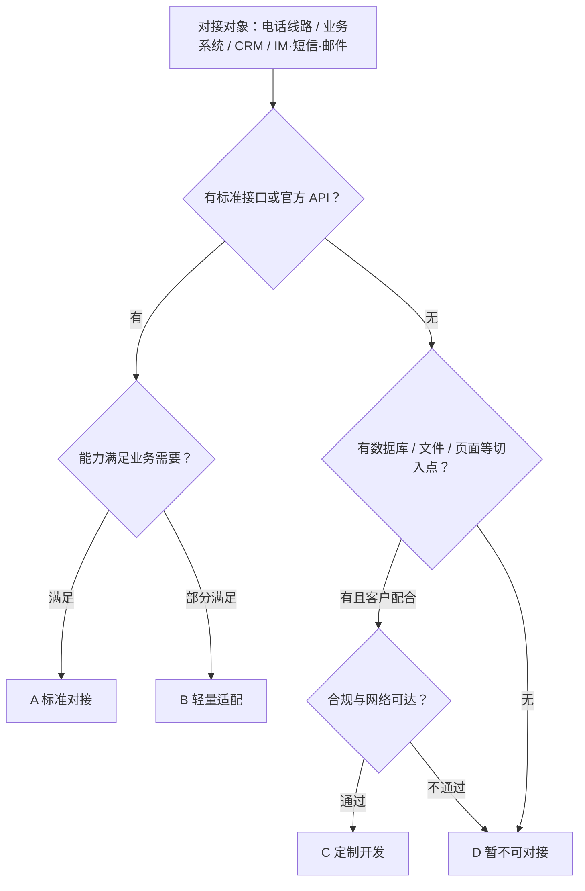

## 概述与适用范围

本文档用于售前与方案评估阶段，统一「可对接性」的判断口径：面对新客户或新项目时，快速判断客户侧的电话线路、业务系统、客户关系管理系统（CRM）、即时通讯（IM）、短信、邮件等渠道，能否与我方语音 AI 系统对接；能走哪条路径、成本量级多少、是否需要定制开发，并给出标准化的判定结论。

我方系统通过自部署的 LiveKit（WebRTC 媒体转发）与 livekit-sip（SIP/RTP 网关）承载语音媒体，出系统后经 SIP Trunk 落地到电话网。各条电话链路的媒体时延计算不在本文重复，见 <cite doc-id="YM1WdkwAOoOGD9xVfjFjDltvpBc" file-type="docx" title="端到端延迟计算" type="doc"></cite>；与客户已有呼叫中心的合作模式见 <cite doc-id="EvRldt9GOoqcFUxAKTujvVvopMh" file-type="docx" title="SI对接方案" type="doc"></cite>；项目分级与交付边界见 <cite doc-id="Xfa9dAyURoVvLOx2jTkjftDgpvZ" file-type="docx" title="项目分级" type="doc"></cite>；定制开发的人力与工期估算见 <cite doc-id="MRbesx2FRhriWGtoYYcjT75UpBb" file-type="sheets" title="人力消耗与开发工期估算" type="doc"></cite>。

## 通用判定框架与结论分级

### 判定五步法

对任一对接对象（电话线路、业务系统、CRM、IM/短信/邮件），按以下五步依次判定，前一步不通过时先解决再进入下一步：

1. **找切入点**：客户侧是否存在标准接口或协议（SIP、REST API、Webhook、SMTP、官方开放平台等）。
2. **验能力**：接口能力是否满足业务需要——鉴权方式、可查/可写的字段范围、实时性、并发与限流、消息与模板限制。
3. **通网络**：网络是否可达（公网 API、企业专线、VPN，或需在客户内网部署适配服务）。
4. **过合规**：数据与安全是否满足——个人信息保护（日本《个人信息保护法》APPI 等）、数据能否按约定范围出客户环境、日志脱敏、客户安全评估。
5. **算成本与工期**：对接成本量级与开发工作量是否在项目预算内。

### 结论分级

| 等级 | 含义 | 典型特征 | 参考周期 |
|-|-|-|-|
| A | 标准对接 | 标准协议或官方 API，纯配置或现成连接器即可 | 1–2 周 |
| B | 轻量适配 | 接口标准，但需少量开发或申请（字段映射、回调改造、账号与模板审核等） | 2–4 周 |
| C | 定制开发 | 无标准接口，但有数据库、文件、页面等可用切入点，需按需求排期开发 | 按人力与工期估算 |
| D | 暂不可对接 | 无任何技术切入点，或客户配合度、合规、安全评估不通过 | 换路径或暂缓 |

每个对接对象的判定结论须包含五项：判定等级、对接路径/方式、前置条件（客户需提供的资源清单）、工作量预估、成本量级。

## 电话线路对接的常见路径及成本

### 常见对接路径

电话线路对接指我方系统与电话网（PSTN）及客户电话系统之间的连接方式。路径编号与《端到端延迟计算》的链路编号保持一致，各路径的媒体时延区间见该文档，此处不再重复：

| 路径 | 媒体走向 | 适用场景 | 前置条件 | 常规结论 |
|-|-|-|-|-|
| 链路一 · 公网外呼（PSTN 直连） | 我方系统 → SIP Trunk → PSTN → 客户手机/固话 | 未与客户电话系统对接，直接拨打客户公网号码 | 无特殊条件，仅需我方线路与号码资源 | A |
| 链路二 · 客户电话交换机（PBX）直连 | 我方系统 → SIP Trunk（企业专线/VPN）→ 客户 PBX → 内线话机，或经 PBX 出局呼叫外线 | 已完成与客户 PBX 的 SIP Trunk 对接 | 客户 PBX 支持标准 SIP；可提供专线或 VPN；网络可达 | A/B |
| 链路三 · PBX 公网号码中转 | 我方系统 → SIP Trunk → PSTN → 客户 PBX 公网号码（DID）→ 出局 PSTN → 客户电话 | 客户 PBX 无法与我方直连，经其公网号码中转（两次穿越 PSTN） | 客户提供可中转的公网号码与分机路由；建议 DID 直达，避免总机语音导航二次拨号 | B |
| 转接人工 · 桥接模式 | 保持与客户的通话不变，另向客服发起一路新呼叫并在我方桥接；客服侧分三条：直连 PBX 内线坐席 / PSTN 客服号码 / PBX 公网号码转分机 | AI 通话中转接人工坐席 | 明确坐席位置（PBX 分机 / 公网号码 / 客户呼叫中心） | 随主链路 |

- 转接人工统一采用桥接模式：人工阶段音频全程经我方桥接，可录音、转写与质检。
- 若客户已有呼叫中心平台且不愿改动，另有三种合作模式（呼叫中心主导电话管理 / 开放接口由我方主导 / 我方直连 PSTN 仅数据同步），见《SI对接方案》。

### 可对接性判定条件（信息收集清单）

判定前先向客户收集以下信息：

- 客户电话系统：有无 PBX 或呼叫中心平台；厂商与型号；是否支持标准 SIP（Trunk 接入与 SIP 分机）。
- 号码资源：外显号码归属（我方申请或客户提供）；日本侧需区分 0AB-J 固定号码与 050 IP 电话号码，两者在外显可信度与可呼范围上不同。
- 网络条件：能否提供企业专线 / VPN / 公网白名单放行；防火墙与地址转换（NAT）策略。
- 媒体参数：编解码（G.711 等）、是否需要转码、PBX 是否支持媒体旁路（通话中媒体不经过 PBX）。
- 话务模型：并发路数、外呼与呼入比例、转接人工比例、每日话务量（分钟数）。
- 坐席侧信息：人工坐席的位置（客户 PBX 分机、公网号码还是客户呼叫中心坐席），决定转接路径。

| 客户条件组合 | 推荐路径 | 常规结论 |
|-|-|-|
| 无 PBX，或暂不对接客户电话系统 | 链路一 | A |
| 有 PBX，支持 SIP，可开通专线 / VPN / 公网直连 | 链路二（时延与成本通常最优） | A/B |
| 有 PBX，但无法与我方直连 | 链路三；不要求内线落地时也可退回链路一 | B |
| 需要转接人工 | 在任一主链路上叠加桥接转接 | 随主链路 |
| 客户已有呼叫中心平台且不愿改动 | 按《SI对接方案》三种模式另行评估 | 另评 |

### 成本构成与量级

| 成本项 | 说明 | 量级参考 |
|-|-|-|
| 线路落地费 | PSTN 话费或 SIP Trunk 分钟费，按运营商 / 线路服务商牌价；各路径均只发生一次 | 差异主要来自落地目标（固定电话 / 手机、国内 / 国际），需按话务模型向线路服务商询价测算 |
| 号码月租 | 外显号码、DID 号码的月租 | 按号商牌价，随号码类型（固定 / 050 / 手机号）与数量而定 |
| SIP Trunk 专线费 | 仅链路二：企业专线或 VPN 的月租与一次性开通费 | 按客户网络条件报价 |
| 平台用量费 | 仅当经第三方云平台（如 Genesys 云）对接时发生 | Genesys 参考价：Audio Connector 按牌价 \$0.10/分钟（约 12 日元/分钟，2026 年 1 月起执行，无免费额度，仅 IVR 通道，不能桥接人工坐席）；BYOC 云中继（客户自带线路接入 Genesys 云）每坐席每月含 5,000 分钟，超额约 \$0.0012/分钟 |
| 定制开发费 | 仅 C 级路径发生 | 按《人力消耗与开发工期估算》测算 |

<callout emoji="💡">
测算口径：对外按两个单价呈现——「AI 接待分钟单价 + 转接人工分钟单价」。LiveKit 为自部署，不产生平台费用；线路落地费各路径均只发生一次；号码月租、专线开通费、坐席许可等一次性或周期性费用不在单价内，按项目另行列示。
</callout>

## 可定制开发的判定条件

当对接对象不满足 A/B（无标准接口，或标准接口能力不足）时，先按本节判定能否走定制开发（C），都不满足才判 D。

### 判 C（可定制开发）的必要条件

以下五条须全部满足：

1. 存在至少一个技术切入点：客户系统数据库（只读视图或专用账号）；客户系统页面背后的接口（可抓包分析且有客户书面认可）；文件或消息中间件交换（CSV 定时导出、SFTP、消息队列）；客户愿意在其系统内开发配合模块（客户研发参与）。
2. 客户配合度达标：有明确的技术对接人；能提供测试环境与脱敏测试数据；有接口文档，或允许联调期间抓包分析。
3. 工作量可控：预估人力与工期在项目预算内（见《人力消耗与开发工期估算》）。
4. 维护责任边界清晰：客户系统升级导致接口或页面变更时，由谁负责适配、响应时效多久，已在合同或方案中约定（见《项目分级》）。
5. 合规允许：涉及的个人信息可按约定范围使用与传输；通过客户安全评估；满足《个人信息保护法》（APPI）等要求。

### 判 D（暂不可对接）的触发条件

- 无任何技术切入点，且客户无研发配合意愿。
- 数据不允许离开客户环境，且客户不接受在客户内网部署适配服务。
- 仅能通过页面逆向获取数据，且客户不予书面认可。
- 定制开发投入接近或超过项目预期收益，投入产出不成立。

### 输出要求

判定为 C 时，输出「定制开发评估表」：切入点类型、涉及的接口与数据清单、预估人日、风险与依赖、验收口径，作为报价与排期依据。

## 业务系统的可对接性判定条件

业务系统指客户侧承载业务数据、AI 对话过程中需要查询或回写的系统：订单、工单、预约、会员、ERP、库存等。判定时按以下「切入点阶梯」从上往下匹配，取第一个命中的阶梯：

| 阶梯 | 切入点 | 常规结论 | 说明 |
|-|-|-|-|
| 1 | 官方 API（REST / SOAP / GraphQL），有文档与测试环境 | A | 纯配置或轻量封装即可 |
| 2 | 官方 SDK / Webhook / 消息推送 | A/B | 少量开发即可对接 |
| 3 | 文件交换（CSV / SFTP 定时导出导入） | B/C | 非实时，仅适合客户名单同步、批量回写等场景 |
| 4 | 数据库直读（只读视图 / 专用账号） | C | 需客户数据库管理员配合，注意字段语义与数据质量 |
| 5 | 页面接口逆向 / RPA | C/D | 脆弱，客户系统升级即失效；须客户书面认可并约定维护责任 |

### 能力匹配判定点

命中阶梯后，再核对以下判定点，任何一项不满足都会影响等级或可行性：

- 鉴权方式：OAuth 2.0 / API Key / Basic / IP 白名单；凭据由谁申请、如何轮换。
- 数据范围：AI 对话所需字段（订单状态、预约记录、会员等级、黑名单等）能否查到；个人信息字段按最小化原则申请。
- 实时性：单次查询响应建议 P95 在 1 秒以内，否则影响对话节奏。
- 并发与限流：接口配额（每秒 / 每日调用上限）能否覆盖话务高峰。
- 写入能力：能否回写通话备注、创建工单或预约；重复提交需有幂等处理。
- 网络可达：公网 API / 专线 / VPN；均不可达时，能否在客户内网部署适配服务。

结论输出：判定等级 + 需客户提供清单（接口文档、测试环境与账号、限流配额、字段字典）。

## CRM 系统的可对接性判定条件

CRM 先套用上节「切入点阶梯」判定：主流 SaaS CRM（Salesforce、Microsoft Dynamics 365、HubSpot、Zoho、kintone 等）开放平台成熟，通常为 A/B；自研 CRM 按阶梯判定。在此基础上，补充 CRM 特有判定点：

| 判定点 | 内容 | 不满足时的处理 |
|-|-|-|
| 通话记录回写 | 能否创建通话记录 / 活动记录并关联联系人，支持自定义字段 | 降级为文件或邮件回写；或判 C 开发中间表 |
| 联系人反查 | 能否按来电 / 去电号码查询联系人；号码字段格式（国码、分隔符）与唯一性 | 格式不一致需开发号码归一化（B） |
| 坐席弹屏 | 人工坐席是否需要来电弹屏；CRM 是否支持 Open CTI 等电话集成框架 | 纯 AI 场景无人工坐席时可忽略 |
| 自定义对象与字段 | 自定义对象 / 字段是否有文档；是否允许新建对象存放 AI 对话结果 | 需客户 CRM 管理员配合（B） |
| API 配额 | API 调用量限额与计费方式能否覆盖话务量 | 需客户扩容，或我方做缓存与请求合并（B） |
| 数据驻留与合规 | CRM 数据能否按约定范围传输给我方；客户合规审批是否通过 | 不允许时只能在客户侧部署适配服务，或判 D |

## IM、短信、邮件等渠道的可对接性判定条件

### 即时通讯（IM）

| 渠道 | 判定要点 | 常规结论 |
|-|-|-|
| LINE 公式账号（日本主流） | Messaging API 标准开放；需以客户主体认证的官方账号接入；消息按类型计费，部分消息模板需审核 | A |
| WhatsApp Business | 经官方云 API 或服务商接入；需企业验证；24 小时客服窗口外只能发送通过审核的模板消息 | A/B |
| 网站在线聊天 | 我方提供聊天组件嵌入客户网站；客户网站可上线脚本即可 | A |
| 飞书 / 企业微信 / 钉钉 | 开放平台 API 成熟；需客户管理员创建应用并授权 | A |
| 客户自建 IM | 有无 API 或消息推送机制，按业务系统「切入点阶梯」判定 | B–D |

共通判定点：账号主体归属（决定计费与合规责任方）；消息模板与审核周期；发送频率限制；用户退订（opt-out）机制。

### 短信

- 发送通道：客户自有短信网关（A/B），或我方对接运营商 / 聚合通道（A，单价按通道牌价）。
- 判定点：可发送的国家与号码类型（日本固定电话多数无法接收短信，以手机号为主）；发送者名称（Sender ID）显示规则；变量模板；到达率与单价；退信与用户回复的处理。

### 邮件

- 发送方式：SMTP 中继（客户提供账号或中继服务）或邮件服务商 API，均为 A。
- 判定点：发信域名归属与 DNS 配置权限（SPF / DKIM / DMARC，未正确配置会明显影响到达率）；模板与变量；退信与投诉处理；发送频率限制。
- 合规：日本《特定电子邮件法》对商业邮件有标明发送者信息与退订方式等要求，发送前需确认模板满足；同时遵守客户内部邮件规范。

## 判定结论汇总模板

对每个客户 / 项目，输出一张汇总表，作为方案与报价的输入：

| 对接对象 | 判定等级 | 对接路径 / 方式 | 前置条件（客户需提供） | 工作量预估 | 成本量级 | 备注 |
|-|-|-|-|-|-|-|
| 电话线路 |  |  |  |  |  |  |
| 业务系统 |  |  |  |  |  |  |
| CRM |  |  |  |  |  |  |
| IM |  |  |  |  |  |  |
| 短信 |  |  |  |  |  |  |
| 邮件 |  |  |  |  |  |  |
