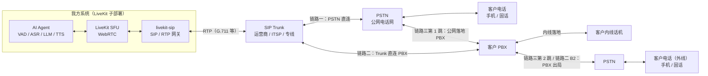
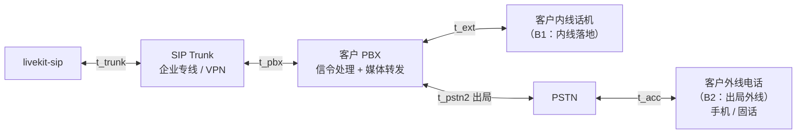
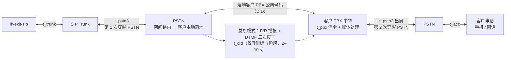

## 概述

本文档定义我方语音 AI 系统到客户电话侧**各条链路的媒体单向时延（OWD）**，给出统一指标口径、分段计算方法与示意图。我方系统通过独立子部署的 **LiveKit**（WebRTC SFU）与 **livekit-sip**（SIP/RTP 网关）承载语音媒体，出系统后经 **SIP Trunk** 落地到电话网，共覆盖 6 条路径（3 条主链路 + 3 条转接路径）：

- **链路一（PSTN 直连）**：livekit-sip → SIP Trunk → PSTN → 客户手机 / 固话。
- **链路二（经客户 PBX）**：livekit-sip → SIP Trunk → 客户 PBX → 客户内线话机；或客户 PBX 出局经 PSTN 呼叫客户外线电话。
- **链路三（PBX 经 PSTN 中转）**：livekit-sip → SIP Trunk → PSTN → 客户 PBX → 出局 PSTN → 客户手机 / 固话（客户 PBX 无法与我方直连时经其公网号码中转，两次穿越 PSTN；转内线分机场景见转接③）。
- **转接人工**：AI 通话中向客服发起第二路呼叫并桥接，客服侧路径分三条——SIP Trunk → 客户 PBX 内线坐席（直连）；SIP Trunk → PSTN → 客服电话；SIP Trunk → PSTN → 客户 PBX 公网号码 → 内线分机（PBX 非直连）。

<callout emoji="💡">
文中分段时延均为**典型参考区间**，用于量级认知与预算建模；对外承诺 SLA 前，必须按第 9 节的打点方法实测校准后替换。
</callout>

## 链路总览

三条 AI 对话主链路共享我方系统内网段（LiveKit SFU、livekit-sip），差异在 SIP Trunk 之后的落地方式；转接人工复用同一 SIP Trunk 出口，仅呼叫目标不同（直连 PBX 分机号、PSTN 客服号码，或经 PSTN 落地的客户 PBX 公网号码），转接后媒体时延按客户侧与客服侧链路分别计算（见第 7 节）。

| 编号 | 媒体路径 | 适用场景 |
|-|-|-|
| 链路一 | 我方系统 → SIP Trunk → PSTN → 客户手机 / 固话 | 未与客户 PBX 对接，直接拨打公网号码 |
| 链路二 | 我方系统 → SIP Trunk → 客户 PBX → 内线话机；或 PBX 出局 → PSTN → 客户外线电话 | 已与客户完成 PBX 对接（企业专线 / VPN SIP Trunk） |
| 链路三 | 我方系统 → SIP Trunk → PSTN → 客户 PBX 中转 → PSTN → 客户手机 / 固话（两次穿越 PSTN） | 客户 PBX 无法与我方直连，外呼经其公网号码（DID）中转出局；转内线分机场景见转接③ |
| 转接① | 我方系统 → SIP Trunk → 客户 PBX → 内线坐席分机 | 客服坐席注册在客户 PBX 分机上，且 PBX 与我方直连 |
| 转接② | 我方系统 → SIP Trunk → PSTN → 客服电话 | 客服为公网手机 / 固话，或不在客户 PBX 分机内 |
| 转接③ | 我方系统 → SIP Trunk → PSTN → 客户 PBX 公网号码 → 内线坐席分机 | 客服坐席在客户 PBX 分机上，但 PBX 与我方无直连（含经 IVR 二次拨号） |

## 时延指标定义与通用计算方法

### 指标定义

本文档统一采用**媒体单向时延（One-Way Delay，OWD）**：通话中，一端发出语音帧 → 对端可播放的单向传播时间，即语音单方向穿过「客户话机 ↔ 我方系统」或「我方系统 ↔ 客服」整条链路的时延。质量目标对标 ITU-T G.114：单向 ≤ 150 ms 为高质量话音。

### 通用计算方法：分段累加

将整条链路划分为标准网段，分别测量或估算各段时延后累加。上、下行媒体路径对称（同一批网段反向传输），实测不对称时分别取值：

$$T_{owd} = \sum_{i} t_{i}$$

即各网段时延之和，网段符号见第 4–6 节分段表。统计口径：各段取 P50 做预算、P95 做上限；抖动缓冲按目标网络条件取稳态值。

## 链路一：SIP Trunk → PSTN → 客户电话

### 分段时延构成

| 符号 | 网段 / 环节 | 构成说明 | 典型参考值（单向） |
|-|-|-|-|
| t_acc | 客户接入网 | 固话本地网 / 移动空口（4G、5G RAN） | 固话 5–30 ms；移动 50–150 ms |
| t_pstn | PSTN | 运营商承载网传输与交换、封包（本地 / 长途 / 国际差异大） | 20–80 ms |
| t_trunk | SIP Trunk | 我方到运营商 / ITSP 的 IP 网络（RTT 一半 + 封包） | 专线 10–30 ms；公网 20–80 ms |
| t_tc | 编解码 / 转码 | livekit-sip 内 G.711 ↔ Opus 转码（帧长 + 算法时延）；编解码一致时仅封包 | 转码 20–40 ms；不转码 5–10 ms |
| t_gw | livekit-sip 网关 | RTP ↔ WebRTC 适配与转发处理 | 5–20 ms |
| t_jb | LiveKit / WebRTC | SFU 转发 + 接收端自适应抖动缓冲（NetEQ） | 30–100 ms |

### 计算公式

链路一的单向媒体时延为各网段之和（上下行对称）：

$$T_{owd}^{A} = t_{acc} + t_{pstn} + t_{trunk} + t_{tc} + t_{gw} + t_{jb}$$

### OWD 参考区间

| 场景 | 单向媒体时延 OWD（参考） |
|-|-|
| 移动客户（公网 SIP Trunk） | 0.14–0.47 s |
| 固话客户（公网 SIP Trunk） | 0.08–0.35 s |
| 固话客户 + 专线 Trunk（最优组合） | 约 0.09 s |

结论：链路一 OWD 参考区间约 **0.08–0.47 s**，主要由接入网（移动空口）、PSTN 承载与转码 / 抖动缓冲贡献；移动客户场景已明显超出 ITU-T G.114 的 150 ms 目标，优化方向为专线 Trunk、减少转码与收紧抖动缓冲。

## 链路二：SIP Trunk → 客户 PBX → 客户话机

### 相对链路一的增量

链路二与链路一共享我方系统内段与 SIP Trunk 段，差异在 Trunk 之后：媒体先进入客户 PBX，再决定落地方式。新增 / 替换的分段如下：

| 符号 | 网段 / 环节 | 构成说明 | 典型参考值（单向） |
|-|-|-|-|
| t_pbx | 客户 PBX | 信令处理 + 媒体转发；若 PBX 转码或媒体不旁路（媒体经过 PBX 媒体板卡）则显著增加 | 媒体转发 2–10 ms；转码 20–60 ms |
| t_ext | 内线线路 | PBX 到内线话机的企业内网链路 | 1–5 ms |
| t_pstn2 | PBX 出局 → PSTN | 仅「PBX 出局呼叫外线」场景存在，等同链路一的 PSTN 段 | 20–80 ms |

### 计算公式

设 B1 = PBX 内线落地，B2 = PBX 出局到外线电话，在链路一公式基础上替换尾段：

$$T_{owd}^{B1} = t_{trunk} + t_{pbx} + t_{ext} + t_{tc} + t_{gw} + t_{jb}$$

$$T_{owd}^{B2} = T_{owd}^{B1} + t_{pstn2} + t_{acc}$$

- **B1（内线落地）**：去掉 PSTN 与接入网两段，换成 PBX 与内线线路，网络段显著小于链路一；
- **B2（出局外线）**：PSTN 与接入网段照旧，仅增加 PBX 一跳；
- 若客户 PBX 支持**媒体旁路**（re-INVITE 后媒体不经过 PBX），t_pbx 仅存在于信令阶段，通话中按 0 计。

## 链路三：SIP Trunk → PSTN → 客户 PBX → PSTN → 客户电话（两次穿越 PSTN）

当客户 PBX 无法与我方系统直连（不具备专线 / VPN SIP Trunk 条件）时，外呼经客户 PBX 的公网号码（DID）中转落地，再由 PBX 出局拨打客户电话：媒体**两次穿越 PSTN**，客户 PBX 只作中转，客户侧终端仍是普通手机 / 固话，不在 PBX 内部（内线分机场景仅出现在转接人工的客服侧，见转接③）。该链路是三条主链路中媒体时延最长的。

### 分段时延构成

共享我方系统内段（t_tc、t_gw、t_jb）与 SIP Trunk 段；之后依次为第 1 次 PSTN 穿越 → 客户 PBX 中转 → 第 2 次 PSTN 穿越 → 客户接入网。新增 / 复用分段如下：

| 符号 | 网段 / 环节 | 构成说明 | 典型参考值（单向） |
|-|-|-|-|
| t_pstn3 | 第 1 次 PSTN 穿越 | 我方 Trunk 出局 → 运营商网间路由 → 客户 PBX 本地落地（公网号码 / DID 线路） | 20–90 ms（长途 / 国际取上限） |
| t_pbx | 客户 PBX 中转 | 信令处理 + 媒体转发（复用 5.1 定义） | 媒体转发 2–10 ms；转码 20–60 ms |
| t_pstn2 + t_acc | 第 2 次 PSTN 穿越与客户接入网 | PBX 出局 → PSTN → 客户接入网 → 客户话机（复用 4.1 / 5.1 定义） | 固话 25–110 ms；移动 70–230 ms |
| t_did | PBX 呼叫路由 | DID 直达：落地即路由出局；总机模式：自动话务员 IVR 播报 + DTMF 二次拨号后才出局，仅存在于呼叫建立阶段 | DID ≈ 0；总机 + IVR 2–10 s |

### 计算公式

$$T_{owd}^{C} = t_{trunk} + t_{pstn3} + t_{pbx} + t_{pstn2} + t_{acc} + t_{tc} + t_{gw} + t_{jb}$$

当两次 PSTN 穿越时延相近（t_pstn3 ≈ t_pstn2 ≈ t_pstn）时，可由链路一直接推导——链路三即「链路一 + 客户 PBX 中转 + 一次额外 PSTN 穿越」：

$$T_{owd}^{C} \approx T_{owd}^{A} + t_{pbx} + t_{pstn}$$

- 相比链路一：多出「客户 PBX 中转 + 一次额外 PSTN 穿越」两段，是三条主链路中媒体时延最长的；
- 客户侧终端仍是普通手机 / 固话；「SIP Trunk → PSTN → 客户 PBX → 内线分机」的一次穿越场景仅用于转接人工的客服侧（转接③，见第 7 节）；
- 媒体单向时延参考：固话客户约 **0.11–0.5 s**，移动客户约 **0.16–0.62 s**；总机模式下的 t_did 只影响接通前的呼叫建立，不影响接通后的媒体时延，建议采用 DID 直达路由。

## 转接人工（桥接模式）

### 桥接转接（本方案唯一方式）

- **桥接转接**：livekit-sip 保持与客户的既有通话不变，另向客服发起一路新呼叫，两路呼叫在我方 LiveKit 房间内桥接；期间客户可听等待音或由 AI 继续播报。转接后媒体固定经我方桥接，两侧链路的媒体时延分别计算后相加，按下节分场景给出。
- **转接③（PBX 非直连）**：客服侧呼叫经 PSTN 拨客户 PBX 的公网号码再转内线分机；DID 直达与总机 IVR 二次拨号只影响接通前的等待，接通后的媒体时延相同（见下节）。

### 转接后的媒体时延

桥接转接下，转接后通话的单向媒体时延为客户侧链路与客服侧链路之和——客户侧链路指客户到我方系统的一段，客服侧链路指我方系统到客服的一段；两侧链路均已含我方系统内的转发段，与第 4–6 节各链路的 OWD 口径一致，对话回路（双向）为其 2 倍（公式中 cust、agent 分别代表客户侧、客服侧链路）：

$$T_{owd}^{after} = T_{owd}^{cust} + T_{owd}^{agent}$$

**客户侧链路**（客户 ↔ 我方系统，按第 4–6 节主链路场景）：

| 客户侧链路场景 | 途经 | 单向媒体 OWD 理论范围 |
|-|-|-|
| 链路一 · 移动客户 | SIP Trunk → PSTN → 移动空口 | 0.14–0.47 s |
| 链路一 · 固话客户 | SIP Trunk → PSTN → 固话本地网 | 0.08–0.35 s |
| 链路二 · PBX 内线（直连） | SIP Trunk → 客户 PBX → 内线话机 | 0.05–0.31 s |
| 链路二 · PBX 出局外线 | SIP Trunk → 客户 PBX → PSTN → 客户话机 | 0.08–0.54 s |
| 链路三 · 经 PBX 中转（固话客户） | SIP Trunk → PSTN → 客户 PBX 中转 → PSTN → 固话本地网 | 0.11–0.5 s |
| 链路三 · 经 PBX 中转（移动客户） | SIP Trunk → PSTN → 客户 PBX 中转 → PSTN → 移动空口 | 0.16–0.62 s |

**客服侧链路**（我方系统 ↔ 客服，按转接路径）：

| 客服侧链路场景 | 途经 | 单向媒体 OWD 理论范围 |
|-|-|-|
| 转接① · Trunk 直连 PBX 内线坐席 | SIP Trunk → 客户 PBX → 内线坐席分机 | 0.05–0.31 s |
| 转接② · PSTN 客服电话（移动） | SIP Trunk → PSTN → 移动空口 | 0.14–0.47 s |
| 转接② · PSTN 客服电话（固话） | SIP Trunk → PSTN → 固话本地网 | 0.08–0.35 s |
| 转接③ · PSTN → PBX 公网号码 → 内线分机 | SIP Trunk → PSTN → 客户 PBX → 内线坐席分机 | 0.09–0.4 s（t_did 仅影响呼叫建立，不影响通话中媒体） |

组合上下界：最优组合（链路二 PBX 直连内线客户 + 转接①）单向约 **0.10–0.62 s**；最差组合（链路三移动客户 + 转接②移动客服）单向约 **0.30–1.09 s**；全部组合的单向理论区间为 **0.10–1.09 s**，对话回路（双向）**0.2–2.2 s**。转接后为纯媒体链路，无 AI 处理段，但两侧链路叠加后 OWD 已明显超出 ITU-T G.114 的 150 ms 目标，长链路组合（链路三 / 移动客户 + 经 PSTN 客服）需在容量规划与体验评估中重点关注。

## 媒体单向时延汇总

| 路径 / 场景 | 单向媒体时延 OWD（参考） |
|-|-|
| 链路一 · 移动客户 | 0.14–0.47 s |
| 链路一 · 固话客户 | 0.08–0.35 s |
| 链路二 · PBX 内线落地（直连） | 0.05–0.31 s |
| 链路二 · PBX 出局外线 | 0.08–0.54 s |
| 链路三 · 经 PBX 中转，两次穿越 PSTN（固话客户） | 0.11–0.5 s |
| 链路三 · 经 PBX 中转，两次穿越 PSTN（移动客户） | 0.16–0.62 s |
| 转接后通话 · 桥接两侧链路合计 | 0.10–1.09 s（对话回路约 0.2–2.2 s） |

解读：各场景 OWD 差异主要由落地路径决定（0.05–0.62 s），链路三（两次穿越 PSTN + PBX 中转）最长；转接统一采用桥接模式，转接后 OWD 为客户侧与客服侧链路之和（0.10–1.09 s），长链路组合（链路三 / 移动客户 + 经 PSTN 客服）需重点关注；转接③建议采用 DID 直达分机。

## 实测打点与校准

### 打点位置

| 位置 | 打点内容 | 工具 |
|-|-|-|
| livekit-sip | RTP 首包收发时间戳、RTCP 时延报告（OWD 直接来源）、丢包与抖动 | 组件日志、tcpdump / Wireshark |
| LiveKit SFU | 房间 join、track 订阅与首帧到达、转发与缓冲耗时 | LiveKit telemetry / Prometheus |
| 整链路拨测 | 测试呼叫注入参考音频并从对端回采，测真实回路时延（÷2 得 OWD） | 拨测脚本 + 打点对齐 |

### 校准流程

1. 对 3 条主链路（5 种落地场景）及转接两侧链路组合分别发起拨测（建议每场景不少于 100 次，覆盖忙时 / 闲时）；
2. 收集各分段时延样本，输出 P50 / P95 / P99 分布；
3. 用实测分布替换本文各表的「典型参考值」，重算汇总表；
4. 差异较大的分段（如国际 PSTN、弱网移动）单列场景口径；
5. 据此确定对外 SLA 口径与告警阈值（如 OWD P95 > 0.5 s 触发告警）。
