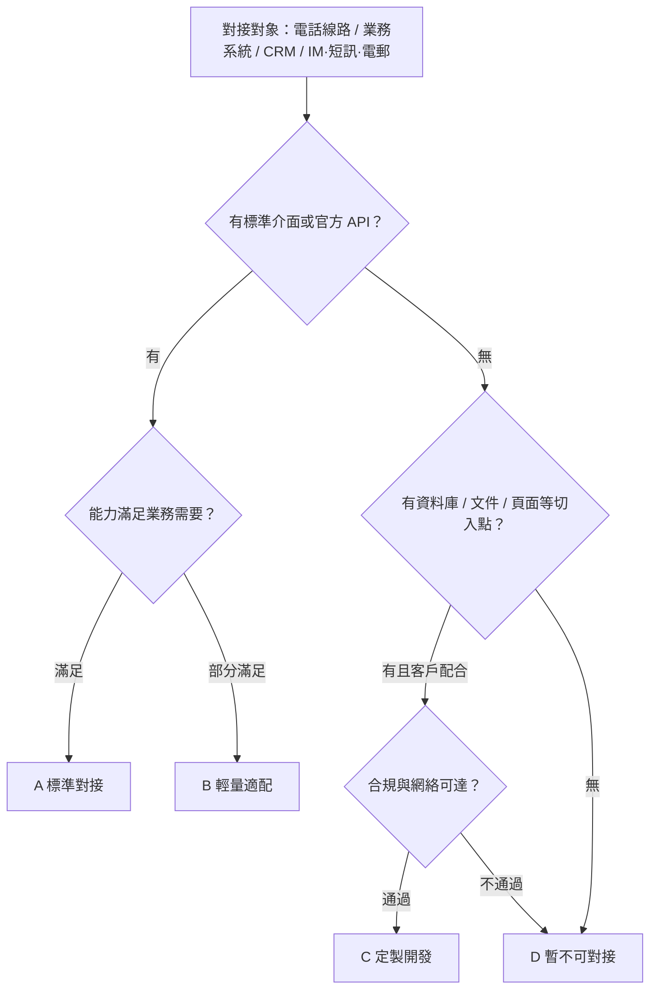

## 概述與適用範圍

本文件用於售前與方案評估階段，統一「可對接性」的判斷口徑：面對新客戶或新項目時，快速判斷客戶側的電話線路、業務系統、客戶關係管理系統（CRM）、即時通訊（IM）、短訊、電郵等渠道，能否與我方語音 AI 系統對接；能走哪條路徑、成本量級多少、是否需要定製開發，並給出標準化的判定結論。

我方系統通過自部署的 LiveKit（WebRTC 媒體轉發）與 livekit-sip（SIP/RTP 閘道）承載語音媒體，出系統後經 SIP Trunk 落地到電話網。各條電話鏈路的媒體時延計算不在本文重複，見 <cite doc-id="LuQ0dnO1woy5J8x2uABjkh8MpUf" file-type="docx" title="[內部文件]端到端延遲計算" type="doc"></cite>；與客戶已有聯絡中心的合作模式見 <cite doc-id="AMQIdOKG6oFMFsxcoKJjcgx4pqw" file-type="docx" title="[內部文件]SI 對接方案" type="doc"></cite>；項目分級與交付邊界見 <cite doc-id="Xfa9dAyURoVvLOx2jTkjftDgpvZ" file-type="docx" title="项目分级" type="doc"></cite>；定製開發的人力與工期估算見 <cite doc-id="MRbesx2FRhriWGtoYYcjT75UpBb" file-type="sheets" title="人力消耗与开发工期估算" type="doc"></cite>。

## 通用判定框架與結論分級

### 判定五步法

對任一對接對象（電話線路、業務系統、CRM、IM/短訊/電郵），按以下五步依次判定，前一步不通過時先解決再進入下一步：

1. **找切入點**：客戶側是否存在標準介面或協議（SIP、REST API、Webhook、SMTP、官方開放平台等）。
2. **驗能力**：介面能力是否滿足業務需要——鑑權方式、可查/可寫的欄位範圍、實時性、併發與限流、消息與模板限制。
3. **通網絡**：網絡是否可達（公網 API、企業專線、VPN，或需在客戶內聯網部署適配服務）。
4. **過合規**：資料與安全是否滿足——個人信息保護（日本《個人信息保護法》APPI 等）、資料能否按約定範圍出客戶環境、日誌脱敏、客戶安全評估。
5. **算成本與工期**：對接成本量級與開發工作量是否在項目預算內。

### 結論分級

| 等級 | 含義 | 典型特徵 | 參考週期 |
|-|-|-|-|
| A | 標準對接 | 標準協議或官方 API，純設定或現成連接器即可 | 1–2 周 |
| B | 輕量適配 | 介面標準，但需少量開發或申請（欄位映射、回調改造、帳戶與模板審核等） | 2–4 周 |
| C | 定製開發 | 無標準介面，但有資料庫、文件、頁面等可用切入點，需按需求排期開發 | 按人力與工期估算 |
| D | 暫不可對接 | 無任何技術切入點，或客戶配合度、合規、安全評估不通過 | 換路徑或暫緩 |

每個對接對象的判定結論須包含五項：判定等級、對接路徑/方式、前置條件（客戶需提供的資源清單）、工作量預估、成本量級。

## 電話線路對接的常見路徑及成本

### 常見對接路徑

電話線路對接指我方系統與電話網（PSTN）及客戶電話系統之間的連接方式。路徑編號與《端到端延遲計算》的鏈路編號保持一致，各路徑的媒體時延區間見該文件，此處不再重複：

| 路徑 | 媒體走向 | 適用場景 | 前置條件 | 常規結論 |
|-|-|-|-|-|
| 鏈路一 · 公網外撥（PSTN 直連） | 我方系統 → SIP Trunk → PSTN → 客戶手機/固網電話 | 未與客戶電話系統對接，直接撥打客戶公網號碼 | 無特殊條件，僅需我方線路與號碼資源 | A |
| 鏈路二 · 客戶電話交換機（PBX）直連 | 我方系統 → SIP Trunk（企業專線/VPN）→ 客戶 PBX → 內線話機，或經 PBX 出局呼叫外線 | 已完成與客戶 PBX 的 SIP Trunk 對接 | 客戶 PBX 支持標準 SIP；可提供專線或 VPN；網絡可達 | A/B |
| 鏈路三 · PBX 公網號碼中轉 | 我方系統 → SIP Trunk → PSTN → 客戶 PBX 公網號碼（DID）→ 出局 PSTN → 客戶電話 | 客戶 PBX 無法與我方直連，經其公網號碼中轉（兩次穿越 PSTN） | 客戶提供可中轉的公網號碼與分機路由；建議 DID 直達，避免總機語音導航二次撥號 | B |
| 轉接人工 · 橋接模式 | 保持與客戶的通話不變，另向客服發起一路新呼叫並在我方橋接；客服側分三條：直連 PBX 內線坐席 / PSTN 客服號碼 / PBX 公網號碼轉分機 | AI 通話中轉接人工坐席 | 明確坐席位置（PBX 分機 / 公網號碼 / 客戶聯絡中心） | 隨主鏈路 |

- 轉接人工統一採用橋接模式：人工階段音頻全程經我方橋接，可錄音、轉寫與質檢。
- 若客戶已有聯絡中心平台且不願改動，另有三種合作模式（聯絡中心主導電話管理 / 開放介面由我方主導 / 我方直連 PSTN 僅資料同步），見《SI對接方案》。

### 可對接性判定條件（信息收集清單）

判定前先向客戶收集以下信息：

- 客戶電話系統：有無 PBX 或聯絡中心平台；廠商與型號；是否支持標準 SIP（Trunk 接入與 SIP 分機）。
- 號碼資源：外顯號碼歸屬（我方申請或客戶提供）；日本側需區分 0AB-J 固定號碼與 050 IP 電話號碼，兩者在外顯可信度與可呼範圍上不同。
- 網絡條件：能否提供企業專線 / VPN / 公網白名單放行；防火牆與位址轉換（NAT）策略。
- 媒體參數：編解碼（G.711 等）、是否需要轉碼、PBX 是否支持媒體旁路（通話中媒體不經過 PBX）。
- 話務模型：併發路數、外撥與呼入比例、轉接人工比例、每日話務量（分鐘數）。
- 坐席側信息：人工坐席的位置（客戶 PBX 分機、公網號碼還是客戶聯絡中心坐席），決定轉接路徑。

| 客戶條件組合 | 推薦路徑 | 常規結論 |
|-|-|-|
| 無 PBX，或暫不對接客戶電話系統 | 鏈路一 | A |
| 有 PBX，支持 SIP，可開通專線 / VPN / 公網直連 | 鏈路二（時延與成本通常最優） | A/B |
| 有 PBX，但無法與我方直連 | 鏈路三；不要求內線落地時也可退回鏈路一 | B |
| 需要轉接人工 | 在任一主鏈路上疊加橋接轉接 | 隨主鏈路 |
| 客戶已有聯絡中心平台且不願改動 | 按《SI對接方案》三種模式另行評估 | 另評 |

### 成本構成與量級

| 成本項 | 説明 | 量級參考 |
|-|-|-|
| 線路落地費 | PSTN 話費或 SIP Trunk 分鐘費，按電訊商 / 線路服務商牌價；各路徑均只發生一次 | 差異主要來自落地目標（固定電話 / 手機、國內 / 國際），需按話務模型向線路服務商詢價測算 |
| 號碼月租 | 外顯號碼、DID 號碼的月租 | 按號商牌價，隨號碼類型（固定 / 050 / 手機號碼）與數量而定 |
| SIP Trunk 專線費 | 僅鏈路二：企業專線或 VPN 的月租與一次性開通費 | 按客戶網絡條件報價 |
| 平台用量費 | 僅當經第三方雲平台（如 Genesys 雲）對接時發生 | Genesys 參考價：Audio Connector 按牌價 \$0.10/分鐘（約 12 日元/分鐘，2026 年 1 月起執行，無免費額度，僅 IVR 通道，不能橋接人工坐席）；BYOC 雲中繼（客戶自帶線路接入 Genesys 雲）每坐席每月含 5,000 分鐘，超額約 \$0.0012/分鐘 |
| 定製開發費 | 僅 C 級路徑發生 | 按《人力消耗與開發工期估算》測算 |

<callout emoji="💡">
測算口徑：對外按兩個單價呈現——「AI 接待分鐘單價 + 轉接人工分鐘單價」。LiveKit 為自部署，不產生平台費用；線路落地費各路徑均只發生一次；號碼月租、專線開通費、坐席許可等一次性或週期性費用不在單價內，按項目另行列示。
</callout>

## 可定製開發的判定條件

當對接對象不滿足 A/B（無標準介面，或標準介面能力不足）時，先按本節判定能否走定製開發（C），都不滿足才判 D。

### 判 C（可定製開發）的必要條件

以下五條須全部滿足：

1. 存在至少一個技術切入點：客戶系統資料庫（只讀視圖或專用帳戶）；客戶系統頁面背後的介面（可抓包分析且有客戶書面認可）；文件或消息中間件交換（CSV 定時導出、SFTP、消息隊列）；客戶願意在其系統內開發配合模塊（客戶研發參與）。
2. 客戶配合度達標：有明確的技術對接人；能提供測試環境與脱敏測試資料；有介面文件，或允許聯調期間抓包分析。
3. 工作量可控：預估人力與工期在項目預算內（見《人力消耗與開發工期估算》）。
4. 維護責任邊界清晰：客戶系統升級導致介面或頁面變更時，由誰負責適配、回應時效多久，已在合同或方案中約定（見《項目分級》）。
5. 合規允許：涉及的個人信息可按約定範圍使用與傳輸；通過客戶安全評估；滿足《個人信息保護法》（APPI）等要求。

### 判 D（暫不可對接）的觸發條件

- 無任何技術切入點，且客戶無研發配合意願。
- 資料不允許離開客戶環境，且客戶不接受在客戶內聯網部署適配服務。
- 僅能通過頁面逆向取得資料，且客戶不予書面認可。
- 定製開發投入接近或超過項目預期收益，投入產出不成立。

### 輸出要求

判定為 C 時，輸出「定製開發評估表」：切入點類型、涉及的介面與資料清單、預估人日、風險與依賴、驗收口徑，作為報價與排期依據。

## 業務系統的可對接性判定條件

業務系統指客戶側承載業務資料、AI 對話過程中需要查詢或回寫的系統：訂單、工單、預約、會員、ERP、庫存等。判定時按以下「切入點階梯」從上往下匹配，取第一個命中的階梯：

| 階梯 | 切入點 | 常規結論 | 説明 |
|-|-|-|-|
| 1 | 官方 API（REST / SOAP / GraphQL），有文件與測試環境 | A | 純設定或輕量封裝即可 |
| 2 | 官方 SDK / Webhook / 消息推送 | A/B | 少量開發即可對接 |
| 3 | 文件交換（CSV / SFTP 定時導出導入） | B/C | 非實時，僅適合客戶名單同步、批量回寫等場景 |
| 4 | 資料庫直讀（只讀視圖 / 專用帳戶） | C | 需客戶資料庫管理員配合，注意欄位語義與資料質量 |
| 5 | 頁面介面逆向 / RPA | C/D | 脆弱，客戶系統升級即失效；須客戶書面認可並約定維護責任 |

### 能力匹配判定點

命中階梯後，再核對以下判定點，任何一項不滿足都會影響等級或可行性：

- 鑑權方式：OAuth 2.0 / API Key / Basic / IP 白名單；憑據由誰申請、如何輪換。
- 資料範圍：AI 對話所需欄位（訂單狀態、預約記錄、會員等級、黑名單等）能否查到；個人信息欄位按最小化原則申請。
- 實時性：單次查詢回應建議 P95 在 1 秒以內，否則影響對話節奏。
- 併發與限流：介面配額（每秒 / 每日呼叫上限）能否覆蓋話務高峯。
- 寫入能力：能否回寫通話備註、建立工單或預約；重複提交需有冪等處理。
- 網絡可達：公網 API / 專線 / VPN；均不可達時，能否在客戶內聯網部署適配服務。

結論輸出：判定等級 + 需客戶提供清單（介面文件、測試環境與帳戶、限流配額、欄位字典）。

## CRM 系統的可對接性判定條件

CRM 先套用上節「切入點階梯」判定：主流 SaaS CRM（Salesforce、Microsoft Dynamics 365、HubSpot、Zoho、kintone 等）開放平台成熟，通常為 A/B；自研 CRM 按階梯判定。在此基礎上，補充 CRM 特有判定點：

| 判定點 | 內容 | 不滿足時的處理 |
|-|-|-|
| 通話記錄回寫 | 能否建立通話記錄 / 活動記錄並關聯聯繫人，支持自定義欄位 | 降級為文件或電郵回寫；或判 C 開發中間表 |
| 聯繫人反查 | 能否按來電 / 去電號碼查詢聯繫人；號碼欄位格式（國碼、分隔符）與唯一性 | 格式不一致需開發號碼歸一化（B） |
| 坐席彈屏 | 人工坐席是否需要來電彈屏；CRM 是否支持 Open CTI 等電話集成框架 | 純 AI 場景無人工坐席時可忽略 |
| 自定義對象與欄位 | 自定義對象 / 欄位是否有文件；是否允許新建對象存放 AI 對話結果 | 需客戶 CRM 管理員配合（B） |
| API 配額 | API 呼叫量限額與計費方式能否覆蓋話務量 | 需客戶擴容，或我方做緩存與要求合併（B） |
| 資料駐留與合規 | CRM 資料能否按約定範圍傳輸給我方；客戶合規審批是否通過 | 不允許時只能在客戶側部署適配服務，或判 D |

## IM、短訊、電郵等渠道的可對接性判定條件

### 即時通訊（IM）

| 渠道 | 判定要點 | 常規結論 |
|-|-|-|
| LINE 公式帳戶（日本主流） | Messaging API 標準開放；需以客戶主體認證的官方帳戶接入；消息按類型計費，部分消息模板需審核 | A |
| WhatsApp Business | 經官方雲 API 或服務商接入；需企業驗證；24 小時客服視窗外只能發送通過審核的模板消息 | A/B |
| 網站在線聊天 | 我方提供聊天組件嵌入客戶網站；客戶網站可上線腳本即可 | A |
| 飛書 / 企業微信 / 釘釘 | 開放平台 API 成熟；需客戶管理員建立應用程式並授權 | A |
| 客戶自建 IM | 有無 API 或消息推送機制，按業務系統「切入點階梯」判定 | B–D |

共通判定點：帳戶主體歸屬（決定計費與合規責任方）；消息模板與審核週期；發送頻率限制；用戶退訂（opt-out）機制。

### 短訊

- 發送通道：客戶自有短訊閘道（A/B），或我方對接電訊商 / 聚合通道（A，單價按通道牌價）。
- 判定點：可發送的國家與號碼類型（日本固定電話多數無法接收短訊，以手機號碼為主）；發送者名稱（Sender ID）顯示規則；變量模板；到達率與單價；退信與用戶回覆的處理。

### 電郵

- 發送方式：SMTP 中繼（客戶提供帳戶或中繼服務）或電郵服務商 API，均為 A。
- 判定點：發信域名歸屬與 DNS 設定權限（SPF / DKIM / DMARC，未正確設定會明顯影響到達率）；模板與變量；退信與投訴處理；發送頻率限制。
- 合規：日本《特定電子電郵法》對商業電郵有標明發送者信息與退訂方式等要求，發送前需確認模板滿足；同時遵守客戶內部電郵規範。

## 判定結論彙總模板

對每個客戶 / 項目，輸出一張彙總表，作為方案與報價的輸入：

| 對接對象 | 判定等級 | 對接路徑 / 方式 | 前置條件（客戶需提供） | 工作量預估 | 成本量級 | 備註 |
|-|-|-|-|-|-|-|
| 電話線路 |  |  |  |  |  |  |
| 業務系統 |  |  |  |  |  |  |
| CRM |  |  |  |  |  |  |
| IM |  |  |  |  |  |  |
| 短訊 |  |  |  |  |  |  |
| 電郵 |  |  |  |  |  |  |
